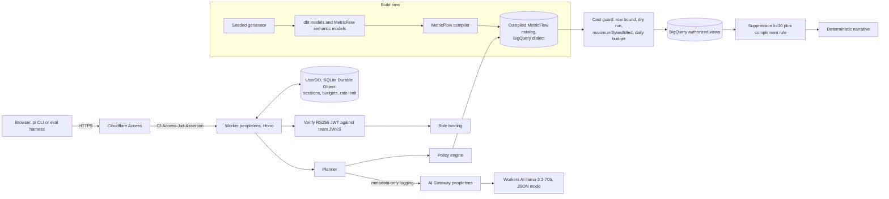
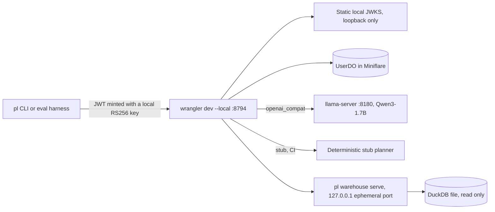

# PeopleLens

Governed AI workforce analytics agent. A Cloudflare Worker turns a natural-language workforce question into a structured query intent with one LLM call, checks it against a role policy, and executes only SQL that MetricFlow generated ahead of time from a governed dbt semantic layer. Results pass through small-cohort suppression before anyone sees them. All data is synthetic and seeded (fictional company "Lumen Works").

The design contract is [SPEC.md](SPEC.md). Build progress is tracked in [PROGRESS.md](PROGRESS.md).

## Status

v1 is being built from scratch, commit by commit, following the plan in SPEC.md section 19. This table is updated in every commit that changes status.

| Area | Status |
|---|---|
| Seeded synthetic HR data with exact counts | done: `pl data generate`, counts asserted by pytest |
| dbt models on DuckDB (local) and BigQuery (production) | DuckDB built and tested locally (94 dbt nodes pass); BigQuery profile parses offline, not yet run against BigQuery |
| MetricFlow semantic layer, six governed metrics | done: `mf validate-configs` passes; queries run on DuckDB; independent Python reference implementation with hand-computed fixture tests |
| Policy (four roles, five approved dimensions, limits) and compiled query catalog | done: 312 entries per dialect compiled by MetricFlow; all 312 DuckDB entries x 3 parameter sets match the independent reference; BigQuery SQL rendered offline, not yet run on BigQuery |
| Local DuckDB warehouse sidecar and byte estimator | done (local only): read-only DuckDB, bearer token, executes only catalog SQL; byte estimates model BigQuery on-demand billing and are labeled as estimates |
| Worker: Access JWT verification and role bindings | done: RS256 verification (static local JWKS, or the team's remote JWKS in production), user and service-token bindings, fail-closed production guards; tested in Miniflare, not yet deployed |
| Worker: policy validation, catalog binding, suppression (k = 10) | done: approved metrics, dimensions, values, grains, ranges and HRBP scope enforced server-side; primary, complementary, hidden-sum and complement-rule suppression with property tests |
| Worker: cost guard, BigQuery client, per-user budgets | done: row bound, per-query byte cap, daily budget and rate limit in a SQLite Durable Object; BigQuery REST client (service-account JWT, bigquery.readonly, maximumBytesBilled on every job) tested against a fetch mock only, never against BigQuery |
| Worker: planner (Workers AI, OpenAI-compatible local, stub) | planned |
| Eval harness (200 items, text-to-SQL baseline) | planned |
| CI (python, worker, stub end-to-end) | planned |
| Ops: doctor, phased bootstrap, deploy, smoke | planned |
| Results | none yet |

Nothing has been deployed to Cloudflare or run against BigQuery from this repo yet.

## Architecture

### Production



### Local and CI



## What runs where

Local pieces are stand-ins. DuckDB is not BigQuery, llama-server is not Workers AI, and locally minted keys are not Cloudflare Access.

| Piece | Local and CI | Production | Status |
|---|---|---|---|
| Worker API | wrangler dev --local on 8794 | Cloudflare Workers (`peoplelens`) | planned |
| Identity | local RS256 keys, static JWKS | Cloudflare Access, team JWKS | planned |
| LLM | Qwen3-1.7B via llama-server, or a deterministic stub | Workers AI llama-3.3-70b via AI Gateway | planned |
| Semantic layer | MetricFlow, DuckDB dialect | MetricFlow, BigQuery dialect | planned |
| Warehouse | DuckDB file (dbt-duckdb) | BigQuery | planned |
| Cost limits | estimated bytes | BigQuery dry run plus maximumBytesBilled | planned |
| Suppression and complement rule | same Worker code | same Worker code | planned |
| Authorized views | plain DuckDB views | BigQuery authorized views | planned |
| Column security, masking | not emulated | BigQuery policy tags and data policies | planned, optional |
| Time travel and recovery | not emulated | dataset time-travel window | planned |
| Audit trail (Queues, Basin Pipelines, Basin Catalog) | pyiceberg SqlCatalog | Queues plus Basin Pipelines plus Basin Catalog | not built |
| Cloudflare Workflows | not used | not used | not used |

Cloudflare Workflows: not used. Nothing in this product is a long-running durable multi-step process.

## Local setup

Requirements: Node 24 or newer, npm, uv 0.12.17, GNU make (Xcode CLT ships GNU make 3.81).

```bash
make setup      # uv sync --frozen, npm ci
```

```bash
make data       # regenerate the seed CSVs (deterministic, seed 20231) and print exact counts
uv run pl data generate --check   # byte-identical check against SHA256SUMS
```

```bash
make dbt        # pl dbt --dialect duckdb seed, then build (models plus every dbt test)
```

`pl dbt --dialect <duckdb|bigquery_compile|bigquery> <dbt args>` is the only supported way to run dbt. It creates `.dev/warehouse/`, points dbt at the dialect's committed profiles directory, and sets `PL_DUCKDB_PATH`. Bare `dbt` fails fast because the DuckDB profile has no default path.

```bash
uv run pl mf validate   # dbt parse (DuckDB) then mf validate-configs --skip-dw
```

```bash
make catalog                      # MetricFlow renders all 312 query shapes for BigQuery, then DuckDB
uv run pl catalog build --check   # recompile and diff against worker/src/generated (CI runs this)
```

The Worker never runs MetricFlow (it is Python). Every query it executes is SQL that MetricFlow generated at build time from the governed semantic layer: one entry per (metric, group-by set of up to two approved dimensions, grain), with named parameters for filters, scope and time range. Filters bind as arrays with an `'__all__'` sentinel, never NULL.

Approximate medians are compared by rank: a median passes when it lies between the sorted salaries 2% of the cohort (at least one rank) either side of the middle values, widened by 1% in value. In the parity sweep 14 of 17,534 DuckDB `approx_quantile` medians fall outside a plain [lower middle x 0.99, upper middle x 1.01] value band (worst 1.84%, at a gap between adjacent salaries) while sitting at the correct rank, so the value-only band from the original spec was too strict.

`uv run pl warehouse serve` (started for you by `make dev-up`) is the local stand-in for BigQuery: it binds 127.0.0.1 on an ephemeral port, needs `PL_WAREHOUSE_TOKEN`, opens the DuckDB file read-only, and refuses any SQL whose sha256 is not in the compiled DuckDB catalog. Its byte counts are estimates (a model of BigQuery on-demand billing with the 10 MB per-table minimum), not BigQuery dry runs.

Further local commands (`make dev-up`, `make eval-stub`) are added as their commits land.

## Production setup

Production needs a Cloudflare account (Workers Paid for the production eval), a Zero Trust organization, and a Google Cloud project with billing. The full guide, including the doctor and the idempotent bootstrap, lands with the ops commit. Until then see SPEC.md section 17.

## Results

No results yet. This section will contain only numbers produced by this repo's scripts, each with its command and date.

## License

MIT
