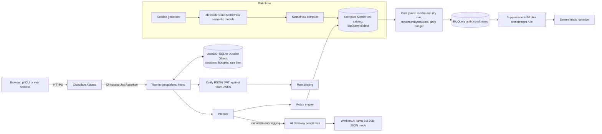
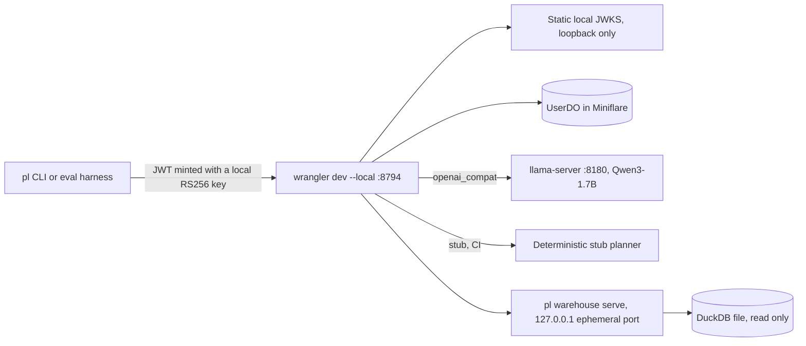

# PeopleLens

Governed AI workforce analytics agent. A Cloudflare Worker turns a natural-language workforce question into a structured query intent with one LLM call, checks it against a role policy, and executes only SQL that MetricFlow generated ahead of time from a governed dbt semantic layer. Results pass through small-cohort suppression before anyone sees them. All data is synthetic and seeded (fictional company "Lumen Works").

The design contract is [SPEC.md](SPEC.md). Build progress is tracked in [PROGRESS.md](PROGRESS.md).

## Status

v1 is being built from scratch, commit by commit, following the plan in SPEC.md section 19. This table is updated in every commit that changes status.

| Area | Status |
|---|---|
| Seeded synthetic HR data with exact counts | done: `pl data generate`, counts asserted by pytest |
| dbt models on DuckDB (local) and BigQuery (production) | DuckDB built and tested locally (94 dbt nodes pass); BigQuery profile parses offline, not yet run against BigQuery |
| MetricFlow semantic layer, six governed metrics | done: `mf validate-configs` passes; queries run on DuckDB; independent Python reference implementation with hand-computed fixture tests |
| Policy (four roles, five approved dimensions, limits) and compiled query catalog | done: 312 entries per dialect compiled by MetricFlow; all 312 DuckDB entries x 3 parameter sets match the independent reference; BigQuery SQL rendered offline, not yet run on BigQuery |
| Local DuckDB warehouse sidecar and byte estimator | done (local only): read-only DuckDB, bearer token, executes only catalog SQL; byte estimates model BigQuery on-demand billing and are labeled as estimates |
| Worker: Access JWT verification and role bindings | done: RS256 verification (static local JWKS, or the team's remote JWKS in production), user and service-token bindings, fail-closed production guards; tested in Miniflare, not yet deployed |
| Worker: policy validation, catalog binding, suppression (k = 10) | done: approved metrics, dimensions, values, grains, ranges and HRBP scope enforced server-side; primary, complementary, hidden-sum and complement-rule suppression with property tests |
| Worker: cost guard, BigQuery client, per-user budgets | done: row bound, per-query byte cap, daily budget and rate limit in a SQLite Durable Object; BigQuery REST client (service-account JWT, bigquery.readonly, maximumBytesBilled on every job) tested against a fetch mock only, never against BigQuery |
| Worker: planner (Workers AI, OpenAI-compatible local, stub) | done: one structured planner call (the LLM picks the action and metric; breakdowns, filters, grain and period are grounded in the question text), deterministic time phrases and request screening, clarifications with selectable options, multi-turn follow-ups, whitelisted logging; 8,000 fuzzed planner outputs leak nothing. Workers AI and AI Gateway are exercised only against a fake binding until deployed |
| Eval harness (200 items, text-to-SQL baseline) | done: 200 frozen items (150 answerable, 20 clarification, 30 adversarial; 214 turns), gold from the independent reference, comparator with median rank bands, leakage checks, pacing, sqlglot-guarded text-to-SQL baseline; official local runs below |
| CI (python, worker, stub end-to-end) | defined in `.github/workflows/ci.yml`; every job's commands pass in a fresh clone on macOS with `CI=true PL_STRICT=1`; not yet run on GitHub's ubuntu-latest runners |
| Ops: doctor, phased bootstrap, deploy, smoke | built and unit-tested with mocked CLIs and HTTP; `make doctor` runs here and reports the missing cloud prerequisites; bootstrap, deploy and smoke have not been run against Cloudflare or Google Cloud |
| Results | local eval (Qwen3-1.7B on DuckDB) and stub CI run, 2026-10-10; no production runs yet |

Nothing has been deployed to Cloudflare or run against BigQuery from this repo yet.

## Architecture

### Production



### Local and CI



## What runs where

Local pieces are stand-ins. DuckDB is not BigQuery, llama-server is not Workers AI, and locally minted keys are not Cloudflare Access.

| Piece | Local and CI | Production | Status |
|---|---|---|---|
| Worker API | wrangler dev --local on 8794 | Cloudflare Workers (`peoplelens`) | planned |
| Identity | local RS256 keys, static JWKS | Cloudflare Access, team JWKS | planned |
| LLM | Qwen3-1.7B via llama-server, or a deterministic stub | Workers AI llama-3.3-70b via AI Gateway | planned |
| Semantic layer | MetricFlow, DuckDB dialect | MetricFlow, BigQuery dialect | planned |
| Warehouse | DuckDB file (dbt-duckdb) | BigQuery | planned |
| Cost limits | estimated bytes | BigQuery dry run plus maximumBytesBilled | planned |
| Suppression and complement rule | same Worker code | same Worker code | planned |
| Authorized views | plain DuckDB views | BigQuery authorized views | planned |
| Column security, masking | not emulated | BigQuery policy tags and data policies | planned, optional |
| Time travel and recovery | not emulated | dataset time-travel window | planned |
| Audit trail (Queues, Basin Pipelines, Basin Catalog) | pyiceberg SqlCatalog | Queues plus Basin Pipelines plus Basin Catalog | not built |
| Cloudflare Workflows | not used | not used | not used |

Cloudflare Workflows: not used. Nothing in this product is a long-running durable multi-step process.

## Local setup

Requirements: Node 24 or newer, npm, uv 0.12.17, GNU make (Xcode CLT ships GNU make 3.81).

```bash
make setup      # uv sync --frozen, npm ci
```

```bash
make data       # regenerate the seed CSVs (deterministic, seed 20231) and print exact counts
uv run pl data generate --check   # byte-identical check against SHA256SUMS
```

```bash
make dbt        # pl dbt --dialect duckdb seed, then build (models plus every dbt test)
```

`pl dbt --dialect <duckdb|bigquery_compile|bigquery> <dbt args>` is the only supported way to run dbt. It creates `.dev/warehouse/`, points dbt at the dialect's committed profiles directory, and sets `PL_DUCKDB_PATH`. Bare `dbt` fails fast because the DuckDB profile has no default path.

```bash
uv run pl mf validate   # dbt parse (DuckDB) then mf validate-configs --skip-dw
```

```bash
make catalog                      # MetricFlow renders all 312 query shapes for BigQuery, then DuckDB
uv run pl catalog build --check   # recompile and diff against worker/src/generated (CI runs this)
```

The Worker never runs MetricFlow (it is Python). Every query it executes is SQL that MetricFlow generated at build time from the governed semantic layer: one entry per (metric, group-by set of up to two approved dimensions, grain), with named parameters for filters, scope and time range. Filters bind as arrays with an `'__all__'` sentinel, never NULL.

Approximate medians are compared by rank: a median passes when it lies between the sorted salaries 2% of the cohort (at least one rank) either side of the middle values, widened by 1% in value. In the parity sweep 14 of 17,534 DuckDB `approx_quantile` medians fall outside a plain [lower middle x 0.99, upper middle x 1.01] value band (worst 1.84%, at a gap between adjacent salaries) while sitting at the correct rank, so the value-only band from the original spec was too strict.

`uv run pl warehouse serve` (started for you by `make dev-up`) is the local stand-in for BigQuery: it binds 127.0.0.1 on an ephemeral port, needs `PL_WAREHOUSE_TOKEN`, opens the DuckDB file read-only, and refuses any SQL whose sha256 is not in the compiled DuckDB catalog. Its byte counts are estimates (a model of BigQuery on-demand billing with the 10 MB per-table minimum), not BigQuery dry runs.

```bash
make dev-up                       # local stack with the stub planner (or: make dev-up ARGS="--llm openai_compat")
uv run pl ask "headcount by department" --role executive
uv run pl chat --role hr_business_partner
make dev-down                     # stops everything and checks ports 8794 and 9244 are free
make llm-up / make llm-down       # llama-server with Qwen3-1.7B on 127.0.0.1:8180 (local stand-in for Workers AI)
```

`make dev-up` creates local RS256 keys in `.dev/keys/`, writes `worker/.dev.vars` (static JWKS, local role bindings, sidecar URL and token), wipes `.dev/wrangler-state`, starts the warehouse sidecar on an ephemeral port and `wrangler dev --local` on 127.0.0.1:8794 (inspector 9244). Every child runs in its own process group and `make dev-down` kills the groups.

```bash
make eval-stub      # stub planner; asserts 200 items, schema-valid responses, zero safety violations,
                    # no RATE_LIMITED or DAILY_BUDGET_EXCEEDED, and at least 143 answers on the answerable slice
make llm-up && make dev-up ARGS="--llm openai_compat" && make eval-local   # Qwen3-1.7B via llama-server, plus the text-to-SQL baseline
uv run pl-eval generate --check   # the frozen eval set equals a fresh deterministic generation
uv run pl-eval gold --check       # eval/gold.json equals the reference implementation
```

The stub planner exists for CI. Its results are never reported as model accuracy.

## Production setup

Nothing below has been run yet: this machine has no Google Cloud CLI, no Google credentials and no Cloudflare login. Everything is scripted so it can run the moment those exist, and `make doctor` names each missing piece with its exact fix.

### What you need (SPEC.md 17.1)

| Provider | What | Cost |
|---|---|---|
| Cloudflare | Account on **Workers Paid** ($5/month; Workers AI on Free stops after 10,000 neurons a day, about a quarter of one production eval) | $5/month |
| Cloudflare | Workers AI, AI Gateway, Zero Trust Free (Access, up to 50 users) | usage; about $0.35 per production eval above the free allocation (estimate) |
| Google Cloud | A project with billing enabled (not the BigQuery sandbox), on-demand pricing, a $5 budget alert | expected $0 (free tier) |
| GitHub | nothing (CI needs no secrets) | $0 |

### Steps

1. Tools and logins:
   ```bash
   brew install --cask gcloud-cli
   make setup
   npx wrangler login && npx wrangler whoami          # note the account id
   gcloud auth login
   gcloud auth application-default login
   ```
2. A custom Cloudflare API token named `peoplelens-bootstrap` (My Profile > API Tokens > Create Custom Token), account-scoped, with: AI Gateway Edit; Workers AI Read and Edit; Access: Apps and Policies Edit; Access: Service Tokens Edit; Access: Organizations, Identity Providers, and Groups Read; Workers Scripts Edit; Account Settings Read. wrangler's OAuth login has no AI Gateway or Access scopes, which is why this token exists. Save it:
   ```bash
   mkdir -m 700 -p .secrets
   printf 'CLOUDFLARE_ACCOUNT_ID=<id>\nCLOUDFLARE_API_TOKEN=<token>\n' > .secrets/cloudflare.env && chmod 600 .secrets/cloudflare.env
   ```
3. Cloudflare console: upgrade to Workers Paid; complete Zero Trust onboarding (team name, Free plan); add the One-time PIN login method (Zero Trust > Settings > Authentication > Login methods). If the account has no workers.dev subdomain, pick one or pass `--workers-subdomain`.
4. Google Cloud project:
   ```bash
   gcloud projects create peoplelens-<suffix> --name="PeopleLens"
   gcloud billing projects link peoplelens-<suffix> --billing-account=<BILLING_ID>
   gcloud config set project peoplelens-<suffix>
   gcloud auth application-default set-quota-project peoplelens-<suffix>
   ```
   Add a $5 budget alert in Billing > Budgets and alerts.
5. Check, then create everything (idempotent and resumable; `--dry-run` prints the plan):
   ```bash
   make doctor
   make bootstrap ARGS="--gcp-project peoplelens-<suffix> --role-emails analyst=<email>,hrbp=<email>:Engineering+Sales,recruiter=<email>,exec=<email>"
   make doctor
   make smoke
   make eval-prod
   ```
   Gmail plus-addresses (`you+exec@gmail.com`) work with One-time PIN.

### What the bootstrap does

| Phase | Steps | Notes |
|---|---|---|
| A: warehouse, gateway, first deploy | enable APIs; datasets `peoplelens_raw` (48 h time travel), `_staging`, `_core`, `_semantic` (168 h); service accounts `peoplelens-worker`, `-eval`, `-analyst` with `bigquery.jobUser` and dataset-level `dataViewer` only; `pl dbt --dialect bigquery seed` and `build` (semantic views are authorized views over core); service-account keys; AI Gateway `peoplelens` (authentication on, logs on, 120 requests per minute); `wrangler deploy --env production --secrets-file` | the Worker is live but answers 503 on every `/api` route until phase B (fails closed) |
| B: Access and identities | team domain; an Access application whose destination is the Worker; an Allow policy for the four emails and a Service Auth policy for four eval service tokens (secrets saved to `.secrets/prod_eval.env`); `ROLE_BINDINGS_JSON`; redeploy with `ACCESS_TEAM_DOMAIN`, `ACCESS_AUD`, `ROLE_BINDINGS_JSON` | if the API cannot create the Access application, it prints the dashboard fallback |
| C: governance | Data Catalog taxonomy with `pii_high`, `protected_class`, `compensation` tags; fine-grained readers granted before tagging; masking policies (SHA256, ALWAYS_NULL, DEFAULT_MASKING_VALUE); `dbt build` with `apply_policy_tags=true` | not on the critical path; doctor reports it separately |

`make smoke` then dry-runs and executes all 312 BigQuery catalog entries and compares them with the reference implementation, checks that BigQuery itself refuses a job capped at 1 MiB `maximumBytesBilled`, asks questions as each of the four service tokens, and fetches one AI Gateway log to confirm custom metadata is present and request and response bodies are absent. It writes `eval/results/<date>-prod-smoke.json`.

Later deploys: `make deploy` (secrets persist), `make deploy ARGS="--rotate-key"` for a fresh service-account key.

## Results

Only numbers produced by this repo's scripts, each with its command and date. These are local numbers: an Apple M5 Mac running Qwen3-1.7B (Q4_0, llama-server) on the DuckDB stand-in, not Workers AI llama-3.3-70b on BigQuery. There are no production numbers yet (`make eval-prod` needs the production setup above).

### Local eval, Qwen3-1.7B (2026-10-10)

Two official runs, both reported. Command: `uv run pl-eval run --llm openai_compat --official`. Reports: [run 2 (latest)](eval/results/2026-10-10-local-qwen3-1.7b.md); run 1 is the same file at commit `c0271ce` in git history.

| Measure | Run 1, commit `a0cc3a6` | Run 2, commit `f4cee41` (after the conversation fixes) | Text-to-SQL baseline (same model, harness only; both runs) |
|---|---|---|---|
| Result accuracy, 150 answerable items | 99.3% (149/150) | **97.3%** (146/150) | 22.0% (33/150) |
| Clarification items (20) | 0/20 | **20/20** | n/a |
| Two-turn items (10) | 0/10 | **10/10** | n/a |
| Adversarial items passed (30) | 30/30 | 29/30 | n/a |
| Safety violations (leakage) | 0 | **0** | 14 on 7 adversarial items |
| p95 latency, answerable items | 3,696 ms | **15,046 ms** | 2,006 ms / 1,571 ms |
| Latency over all 214 turns (p50 / p95 / max) | 2,201 / 3,639 / 4,506 ms | 4,028 / 15,046 / 40,052 ms | n/a |

What changed between the runs: run 1 showed that the 1.7B model never asked a clarifying question and that a short reply such as "Headcount, please." lost the previous turn's filters. The fixes (validated on dev items only) made the metric a grounded slot (no metric named: ask), kept the conversation's scope for short replies, and turned the model's spurious refusals of ambiguous in-domain questions into clarifications. Two answerable items that name no metric ("What does the L2 population look like by ...") now get a clarification instead of a guessed headcount, which the eval scores as wrong.

Latency in run 2 is not comparable to run 1: this Mac was shared with other builds during run 2 (load average about 60 to 85 over the run, seen right after it ended), llama-server's generation slowed from about 18 ms to as much as 160 ms per token, and two items hit the Worker's 20 s local LLM timeout (they were answered with "Could you rephrase?", which is why one adversarial item failed its expected-type check). The target of p95 below 5 s was met in run 1 and missed in run 2; the production target needs Workers AI numbers from `make eval-prod`. Later reports record the machine's load average.

### Stub run (CI fixture, 2026-10-10)

`uv run pl-eval run --llm stub --assert-safety --official` against commit `c0271ce`; report: [eval/results/2026-10-10-local-stub.md](eval/results/2026-10-10-local-stub.md). 200 items and 214 turns processed, every response schema-valid, 0 safety violations, no `RATE_LIMITED` or `DAILY_BUDGET_EXCEEDED`, 148 answers on the answerable slice. The stub is a keyword planner for CI; its accuracy is not reported.

### What the numbers do and do not show

- Suppression is guaranteed per response and per response pair (a result and its widened counterpart). Someone who sums several separate single-group queries can still recover a small group; closing that needs query auditing or noise, which v1 does not do.
- The semantic path's accuracy rests on deterministic grounding as much as on the model: the LLM picks the action and the metric, while time phrases, grain words, breakdowns and filter values are read from the question text (see SPEC.md and PROGRESS.md).

## License

MIT
