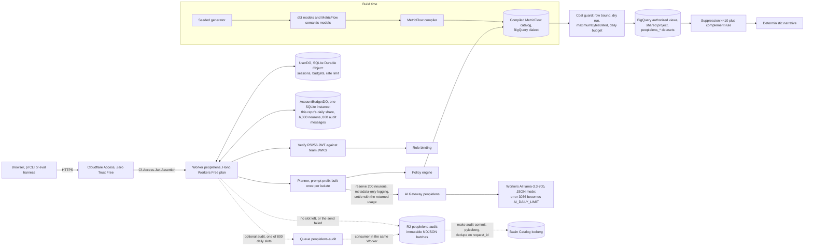
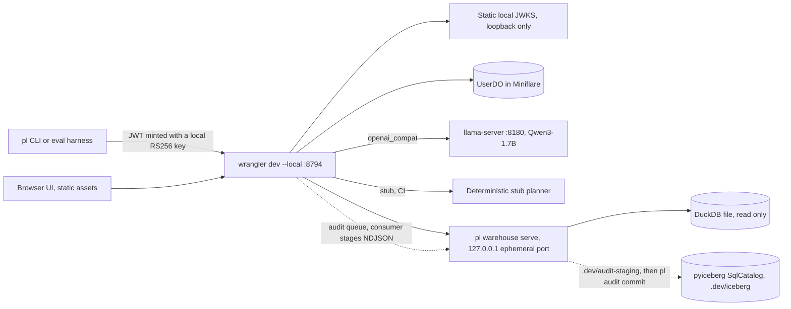

# PeopleLens

Governed AI workforce analytics agent. A Cloudflare Worker turns a natural-language workforce question into a structured query intent with one LLM call, checks it against a role policy, and executes only SQL that MetricFlow generated ahead of time from a governed dbt semantic layer. Results pass through small-cohort suppression before anyone sees them. All data is synthetic and seeded (fictional company "Lumen Works").

The design contract is [SPEC.md](SPEC.md). Build progress is tracked in [PROGRESS.md](PROGRESS.md).

## Status

v1 was built from scratch, commit by commit, following the plan in SPEC.md section 19, and then moved onto the **Cloudflare Workers Free plan** in a Cloudflare account and a Google Cloud project that three other repos share (SPEC.md section 25, [ADR 0001](docs/adr/0001-production-on-workers-free-plan.md), migration commits M1 to M8). Every planned commit is done; every check passes locally and in GitHub Actions on `ubuntu-latest`, and the official local evals were re-run on the final code (2026-10-11). What remains needs cloud accounts and an operator (see Production setup; `make doctor` lists each missing piece). This table is updated in every commit that changes status.

| Area | Status |
|---|---|
| Seeded synthetic HR data with exact counts | done: `pl data generate`, counts asserted by pytest |
| dbt models on DuckDB (local) and BigQuery (production) | DuckDB built and tested locally (94 dbt nodes pass); the production BigQuery profile compiles offline (every model parses as BigQuery SQL, authorized views read only `peoplelens_core`), not yet run against BigQuery; every dbt job is capped at 1 GiB billed and labeled `app=peoplelens` |
| MetricFlow semantic layer, six governed metrics | done: `mf validate-configs` passes; queries run on DuckDB; independent Python reference implementation with hand-computed fixture tests |
| Policy (four roles, five approved dimensions, limits) and compiled query catalog | done: 312 entries per dialect compiled by MetricFlow; all 312 DuckDB entries x 3 parameter sets match the independent reference; BigQuery SQL rendered offline, not yet run on BigQuery |
| Local DuckDB warehouse sidecar and byte estimator | done (local only): read-only DuckDB, bearer token, executes only catalog SQL; byte estimates model BigQuery on-demand billing and are labeled as estimates |
| Worker: Access JWT verification and role bindings | done: RS256 verification (static local JWKS, or the team's remote JWKS in production), user and service-token bindings, fail-closed production guards; tested in Miniflare, not yet deployed |
| Worker: policy validation, catalog binding, suppression (k = 10) | done: approved metrics, dimensions, values, grains, ranges and HRBP scope enforced server-side; primary, complementary, hidden-sum and complement-rule suppression with property tests |
| Worker: cost guard, BigQuery client, per-user budgets | done: row bound, per-query byte cap, daily budget and rate limit in a SQLite Durable Object; BigQuery REST client (service-account JWT, bigquery.readonly, maximumBytesBilled on every job, one dry run per catalog key per isolate, at most 3 polls per query) tested against a fetch mock only, never against BigQuery |
| Worker: planner (Workers AI, OpenAI-compatible local, stub) | done: one structured planner call (the LLM picks the action and metric; breakdowns, filters, grain and period are grounded in the question text), deterministic time phrases and request screening, clarifications with selectable options, multi-turn follow-ups, whitelisted logging; 8,000 fuzzed planner outputs leak nothing. Workers AI and AI Gateway are exercised only against a fake binding until deployed |
| Workers Free plan safeguards | done and tested, not yet deployed: `AccountBudgetDO` holds this repo's share of the account's daily allowances (6,000 Workers AI neurons, 800 audit queue messages), reserved before and settled after every Workers AI call; Workers AI error 3036 (daily allocation used up) is the refusal `AI_DAILY_LIMIT` (503, `Retry-After` to 00:00 UTC), 3040 is retried once, 5035 is a configuration error; the planner prompt prefix is built once per isolate; a question makes at most 19 external subrequests (Free limit 50) |
| Eval harness (200 items, text-to-SQL baseline) | done: 200 frozen items (150 answerable, 20 clarification, 30 adversarial; 214 turns), gold from the independent reference, comparator with median rank bands, leakage checks, pacing, sqlglot-guarded text-to-SQL baseline; official local runs below. The production eval is resumable and budget-capped (about 5 UTC days per run), not yet run |
| CI (python, worker, stub end-to-end) | green on GitHub Actions `ubuntu-latest` (ubuntu-24.04): all 15 runs passed, from the commit that added the workflow (`91e2819`) to `b290b5c` (run 38123513792, 2026-10-11: 589 pytest; typecheck, web 3 and worker 306 vitest, production dry-run bundle; stub eval with 0 safety violations and the audit commit, 214 rows then 0). Every job's commands also pass in a fresh clone on macOS |
| Ops: doctor, phased bootstrap, deploy, smoke | built and unit-tested with mocked CLIs and HTTP; no step needs Workers Paid; every BigQuery job the ops code runs carries a byte cap. `make doctor` ran read-only against the owner's real Cloudflare and Google Cloud logins on 2026-10-11: two required items are missing (the Cloudflare API token file, and billing, because the shared project is linked to a closed billing account), and it lists the steps it can check only once the token exists (One-time PIN among them). Bootstrap, deploy and smoke have not been run against Cloudflare or Google Cloud |
| Audit trail | done locally: one metadata-only event per question (HMAC of the subject, decision codes, counts, bytes, timings; never question text or values) through a queue into immutable staged NDJSON objects, then `pl audit commit` appends them to an Iceberg table exactly once (the CI e2e job checks 214 rows, then 0 on a replay); production path (Queue, R2 staging, Basin Catalog, all on Workers Free) scripted in the bootstrap, not run |
| Web UI (React, served as Worker static assets) | done: chat with answer tables, hidden-cell notes and clickable clarification options; checked in a browser against the local stack; production serving is behind Access once deployed |
| Results | five official local evals (Qwen3-1.7B on DuckDB; the latest, on the final Free plan code, 2026-10-11) and the official stub runs; no production runs yet |

Nothing has been deployed to Cloudflare or run against BigQuery from this repo yet.

## Architecture

### Production



### Local and CI



## What runs where

Local pieces are stand-ins. DuckDB is not BigQuery, llama-server is not Workers AI, and locally minted keys are not Cloudflare Access.

| Piece | Local and CI | Production | Status |
|---|---|---|---|
| Worker API | wrangler dev --local on 8794 | Cloudflare Workers (`peoplelens`) on the Workers Free plan | local verified; production pending deploy |
| Identity | local RS256 keys, static JWKS | Cloudflare Access (Zero Trust Free), team JWKS | stand-in locally; Access pending |
| LLM | Qwen3-1.7B via llama-server, or a deterministic stub | Workers AI llama-3.3-70b via AI Gateway | stand-in locally; Workers AI pending |
| Workers AI allowance | none (no Workers AI locally) | 10,000 neurons per account per UTC day, shared with three other repos; this repo's share 6,000, enforced by `AccountBudgetDO`; error 3036 becomes `AI_DAILY_LIMIT` | prod only; tested against fakes |
| Semantic layer | MetricFlow, DuckDB dialect | MetricFlow, BigQuery dialect | both compiled in CI; BigQuery SQL not yet executed |
| Warehouse | DuckDB file (dbt-duckdb) | BigQuery in a Google Cloud project shared with three other repos (`peoplelens_*` datasets, scoped grants) | stand-in locally; BigQuery pending |
| Cost limits | estimated bytes | BigQuery dry run plus maximumBytesBilled on every job | estimate locally |
| Suppression and complement rule | same Worker code | same Worker code | both (tested, fuzzed, evaluated locally) |
| Authorized views | plain DuckDB views | BigQuery authorized views (phase A) | prod only, not run |
| Column security, masking | not emulated | BigQuery policy tags and data policies (phase C), masking demo in `make smoke ARGS="--drills"` | prod only, optional, not run |
| Time travel and recovery | not emulated | dataset time-travel windows (phase A), runbook, recovery drill in `make smoke ARGS="--drills"` | prod only, not run |
| Web UI | Vite build served by wrangler dev assets on 8794 (paste a token from `pl token`) | Workers static assets behind Cloudflare Access | local verified |
| Audit trail (metadata only) | Miniflare queue; the consumer stages NDJSON through the sidecar into `.dev/audit-staging`; `uv run pl audit commit` appends to a pyiceberg SqlCatalog table (`uv run pl audit tail`) | Queue `peoplelens-audit` (800 messages a day, then direct R2 puts), R2 staging bucket `peoplelens-audit`, `make audit-commit` into the Basin Catalog Iceberg table `peoplelens.audit_events` through pyiceberg RestCatalog (`make bootstrap ARGS="--with-audit ..."`); no Basin Pipelines (Workers Paid only) | local verified; production coded, not run |
| Production eval | one sitting | resumable and budget-capped, about 5 UTC days per run on one commit and one deployed build (`make eval-prod`) | prod only, not run |
| Cloudflare plan | n/a | Workers Free; no Workers Paid feature anywhere (pinned by tests) | prod only |
| Cloudflare Workflows | not used | not used | not used |

Cloudflare Workflows: not used. Nothing in this product is a long-running durable multi-step process. Queues, R2 and Basin Catalog are used only by the optional audit trail; Basin Pipelines is not used (it needs Workers Paid).

## Local setup

Requirements: Node 24 or newer, npm, uv 0.12.17, GNU make (Xcode CLT ships GNU make 3.81).

```bash
make setup      # uv sync --frozen, npm ci
```

```bash
make data       # regenerate the seed CSVs (deterministic, seed 20231) and print exact counts
uv run pl data generate --check   # byte-identical check against SHA256SUMS
```

```bash
make dbt        # pl dbt --dialect duckdb seed, then build (models plus every dbt test)
```

`pl dbt --dialect <duckdb|bigquery_compile|bigquery> <dbt args>` is the only supported way to run dbt. It creates `.dev/warehouse/`, points dbt at the dialect's committed profiles directory, and sets `PL_DUCKDB_PATH`. Bare `dbt` fails fast because the DuckDB profile has no default path.

```bash
uv run pl mf validate   # dbt parse (DuckDB) then mf validate-configs --skip-dw
```

```bash
make catalog                      # MetricFlow renders all 312 query shapes for BigQuery, then DuckDB
uv run pl catalog build --check   # recompile and diff against worker/src/generated (CI runs this)
```

The Worker never runs MetricFlow (it is Python). Every query it executes is SQL that MetricFlow generated at build time from the governed semantic layer: one entry per (metric, group-by set of up to two approved dimensions, grain), with named parameters for filters, scope and time range. Filters bind as arrays with an `'__all__'` sentinel, never NULL.

Approximate medians are compared by rank: a median passes when it lies between the sorted salaries 2% of the cohort (at least one rank) either side of the middle values, widened by 1% in value. In the parity sweep 14 of 17,534 DuckDB `approx_quantile` medians fall outside a plain [lower middle x 0.99, upper middle x 1.01] value band (worst 1.84%, at a gap between adjacent salaries) while sitting at the correct rank, so the value-only band from the original spec was too strict.

`uv run pl warehouse serve` (started for you by `make dev-up`) is the local stand-in for BigQuery: it binds 127.0.0.1 on an ephemeral port, needs `PL_WAREHOUSE_TOKEN`, opens the DuckDB file read-only, and refuses any SQL whose sha256 is not in the compiled DuckDB catalog. Its byte counts are estimates (a model of BigQuery on-demand billing with the 10 MB per-table minimum), not BigQuery dry runs.

```bash
make dev-up                       # local stack with the stub planner; the UI is at http://127.0.0.1:8794/ (or: make dev-up ARGS="--llm openai_compat")
uv run pl ask "headcount by department" --role executive
uv run pl chat --role hr_business_partner
uv run pl audit commit && uv run pl audit tail   # staged audit events into the local Iceberg table, then the latest rows
make dev-down                     # stops everything and checks ports 8794 and 9244 are free
make llm-up / make llm-down       # llama-server with Qwen3-1.7B on 127.0.0.1:8180 (local stand-in for Workers AI)
```

`make dev-up` creates local RS256 keys in `.dev/keys/`, writes `worker/.dev.vars` (static JWKS, local role bindings, sidecar URL and token), wipes `.dev/wrangler-state`, starts the warehouse sidecar on an ephemeral port and `wrangler dev --local` on 127.0.0.1:8794 (inspector 9244). Every child runs in its own process group and `make dev-down` kills the groups.

```bash
make eval-stub      # stub planner; asserts 200 items, schema-valid responses, zero safety violations,
                    # no RATE_LIMITED, DAILY_BUDGET_EXCEEDED or AI_DAILY_LIMIT, and at least 143 answers on the answerable slice
make llm-up && make dev-up ARGS="--llm openai_compat" && make eval-local   # Qwen3-1.7B via llama-server, plus the text-to-SQL baseline
uv run pl-eval generate --check   # the frozen eval set equals a fresh deterministic generation
uv run pl-eval gold --check       # eval/gold.json equals the reference implementation
```

The stub planner exists for CI. Its results are never reported as model accuracy.

Refusal codes returned by `POST /api/ask` (SPEC.md 7.4): `UNAUTHENTICATED`, `NO_ROLE_BINDING`, `METRIC_NOT_ALLOWED`, `DIMENSION_NOT_APPROVED`, `PII_REQUEST`, `WRITE_REQUEST`, `SCOPE_VIOLATION`, `GRAIN_NOT_ALLOWED`, `TIME_RANGE_INVALID`, `RESULT_TOO_LARGE`, `COST_LIMIT_EXCEEDED`, `DAILY_BUDGET_EXCEEDED`, `RATE_LIMITED` (HTTP 429), `OUT_OF_DOMAIN`, `PLANNER_INVALID_OUTPUT`, and `AI_DAILY_LIMIT` (HTTP 503 with `Retry-After` set to the seconds until 00:00 UTC: this repo's Workers AI share for the UTC day is used up, or Workers AI answered error 3036 because the account's free daily allocation is). The planner model can choose only the first fifteen; `AI_DAILY_LIMIT` is server-only. A model that needs Workers Paid (Workers AI error 5035) gives `CONFIG_INVALID` (HTTP 503), and a capacity error (3040) is retried once after 1 s.

```bash
npm run bench:cpu --workspace worker   # CPU per /api/ask on the production wiring, in Node (not a CI gate)
```

`bench:cpu` runs the production request path (BigQuery catalog, Workers AI client with its budget, BigQuery client, remote JWKS) with fakes only beyond each network or Durable Object boundary, over the 214 eval turns in one warm process and in 5 fresh processes. Workers Free allows 10 ms of CPU per request; the latest numbers are under Workers Free plan budget below.

## Production setup

Production runs entirely on the **Cloudflare Workers Free plan** (do not upgrade; nothing needs Workers Paid), in a Cloudflare account and a Google Cloud project that three other repos share. Every resource this repo creates starts with `peoplelens`, every data grant is scoped to a dataset or a resource, the only project-level role any `peoplelens-*` identity holds is `roles/bigquery.jobUser`, and every BigQuery job carries a byte cap. Placeholders below (`<shared-project-id>`, `<account-id>`, `<billing-account-id>`, `<you>`, `<domain>`) stand for your own values; none are committed here. The full checklist, with what was verified and how, is SPEC.md section 17. Of the steps below, only `make doctor` (read-only) has been run from this repo against the real accounts (2026-10-11); it names each missing piece with its exact fix, and on that day two were missing: the Cloudflare API token file, and billing (the shared project is linked to a closed billing account).

### What you need (SPEC.md 17.1)

| Provider | What | Cost |
|---|---|---|
| Cloudflare | Account on **Workers Free**, logged in with `npx wrangler login`, with a workers.dev subdomain | $0 |
| Cloudflare | Workers AI on Free: 10,000 neurons per account per UTC day, shared with the other repos; this repo caps itself at 6,000 for the Worker plus 2,000 for the eval baseline on eval days | $0 (no overage on Free: calls fail with 3036, which the Worker reports as `AI_DAILY_LIMIT`) |
| Cloudflare | AI Gateway (core features free), Zero Trust Free (Access, 50 seats shared; this repo needs 5) with the One-time PIN login method | $0 |
| Cloudflare | Only for the optional audit trail: R2 activated with a card on file, Queues and Basin Catalog on Free | $0 inside the free allowances |
| Google Cloud | The shared project with billing enabled (the BigQuery sandbox rejects DML and expires tables after 60 days), on-demand pricing, a $5 budget alert | expected $0: one full production cycle scans about 12 GB of the 1 TiB monthly free tier |
| GitHub | nothing (CI needs no secrets) | $0 |

### Steps

1. Tools and logins:
   ```bash
   brew install --cask gcloud-cli
   make setup
   npx wrangler login && npx wrangler whoami          # note the account id
   gcloud auth login
   gcloud auth application-default login
   gcloud config set project <shared-project-id>
   gcloud auth application-default set-quota-project <shared-project-id>
   ```
2. A custom Cloudflare API token named `peoplelens-bootstrap` (My Profile > API Tokens > Create Custom Token), account-scoped, with: AI Gateway Edit; Workers AI Read and Edit; Access: Apps and Policies Edit; Access: Service Tokens Edit; Access: Organizations, Identity Providers, and Groups Read; Workers Scripts Edit; Account Settings Read. wrangler's OAuth login has no AI Gateway or Access scopes, which is why this token exists. Save it:
   ```bash
   mkdir -m 700 -p .secrets && touch .secrets/cloudflare.env && chmod 600 .secrets/cloudflare.env
   nano .secrets/cloudflare.env    # two lines: CLOUDFLARE_ACCOUNT_ID=<account-id> and CLOUDFLARE_API_TOKEN=<token>
   ```
   Paste the token in an editor rather than on the command line, so it stays out of your shell history.
3. Cloudflare console: stay on Workers Free; complete Zero Trust onboarding (team name, Free plan) and add the One-time PIN login method (Zero Trust > Integrations > Identity providers > Add new identity provider > One-time PIN). If the account has no workers.dev subdomain, pick one or pass `--workers-subdomain`.
4. Google Cloud: enable billing on the shared project and add a budget alert (Billing > Budgets and alerts, $5, alerts at 50, 90 and 100%; optionally a second budget on the label `app=peoplelens`, which every PeopleLens job carries). The account you link must be open (`OPEN` is `True`); a project linked to a closed account shows `billingEnabled: false`, and linking it again does not help, so reopen it first (Billing > Manage billing accounts, clear the Active filter, open the account > Account management > Reopen billing account; Google says the projects linked to it then start incurring charges again, so rerun `make doctor` to confirm) or link another one. `make doctor` says which case applies:
   ```bash
   gcloud billing accounts list
   gcloud billing projects link <shared-project-id> --billing-account=<billing-account-id>
   ```
5. Check, then create everything (idempotent and resumable; `--dry-run` prints the plan). The doctor is read-only; it lists every check with its exact fix (including the ones it cannot run until the API token exists) and ends with the missing required items in order. Before the bootstrap, the APIs it will enable are a warning, not a failure. Role identities can be plus-addresses of one mailbox, each a separate Zero Trust seat:
   ```bash
   make doctor ARGS="--gcp-project <shared-project-id>"
   make bootstrap ARGS="--gcp-project <shared-project-id> --role-emails analyst=<you>+analyst@<domain>,hrbp=<you>+hrbp@<domain>:Engineering+Sales,recruiter=<you>+recruiter@<domain>,exec=<you>+exec@<domain>"
   make doctor ARGS="--gcp-project <shared-project-id>"
   ```
6. Smoke, on a UTC day without a production eval (it needs about 2,500 neurons, at most 4,300, and stops if fewer than 4,800 of this repo's 6,000 are left):
   ```bash
   make smoke                                   # writes eval/results/<date>-prod-smoke.json
   git add eval/results && git commit -m "eval: production smoke"
   ```
7. Production eval, resumable over about 5 UTC days (18 at most, if every planner call were retried), on one commit and one deployed build:
   ```bash
   make eval-prod ARGS="--official"             # day 1 (an official run needs a clean tree and the deployed build = HEAD)
   make eval-prod ARGS="--official --resume"    # once per UTC day until the report is written
   ```
   An eval day uses up to 8,000 of the account's 10,000 neurons, so agree eval days with the other repos, or lower a day's share with `--neurons-today <n>`. The report goes to `eval/results/<first day>-prod-llama-3.3-70b.{json,md}` and records the days, the neurons per day and the model.

### Optional: the audit trail in production

Not needed for anything on the resume, and it runs on Workers Free (no Basin Pipelines). If you want it: add Queues Edit and Workers R2 Storage Edit to the `peoplelens-bootstrap` token; run `make bootstrap ARGS="--gcp-project <shared-project-id> --phase a --with-audit"` (lists first, then creates queue `peoplelens-audit`, R2 bucket `peoplelens-audit` and enables Basin Catalog on it, records its Catalog URI and Warehouse, and redeploys with the generated config and `AUDIT_HMAC_KEY`). To commit staged events into the Iceberg table, create an R2 API token with Admin Read & Write (R2 > Manage R2 API Tokens), add its token value, Access Key ID and Secret Access Key to `.secrets/cloudflare.env` as `AUDIT_R2_TOKEN`, `AUDIT_R2_ACCESS_KEY_ID` and `AUDIT_R2_SECRET_ACCESS_KEY`, then run `make audit-commit` whenever you want the table up to date (`make smoke ARGS="--with-audit"` checks it end to end). That token covers every bucket in the account, so keep it in `.secrets/` and rotate it after use.

### What the bootstrap does

| Phase | Steps | Notes |
|---|---|---|
| A: warehouse, gateway, first deploy | enable APIs; datasets `peoplelens_raw` (48 h time travel), `_staging`, `_core`, `_semantic` (168 h); service accounts `peoplelens-worker`, `-eval`, `-analyst` with `bigquery.jobUser` (the only project-level role) and dataset-level `dataViewer` only; `pl dbt --dialect bigquery seed` and `build` (semantic views are authorized views over core; 1 GiB cap per dbt job); service-account keys; AI Gateway `peoplelens` (authentication on, logs on, 120 requests per minute; retried without `log_management` if the API rejects it); `wrangler deploy --env production --secrets-file --var BUILD_COMMIT:<HEAD>` | the Worker is live but answers 503 on every `/api` route until phase B (fails closed) |
| B: Access and identities | team domain; an Access application whose destination is the Worker; an Allow policy for the four emails and a Service Auth policy for four eval service tokens (secrets saved to `.secrets/prod_eval.env`); `ROLE_BINDINGS_JSON`; redeploy with `ACCESS_TEAM_DOMAIN`, `ACCESS_AUD`, `ROLE_BINDINGS_JSON` | if the API cannot create the Access application, it prints the dashboard fallback |
| C: governance | Data Catalog taxonomy `peoplelens` with `pii_high`, `protected_class`, `compensation` tags; fine-grained readers granted before tagging; masking policies `peoplelens_<tag>` (SHA256, ALWAYS_NULL, DEFAULT_MASKING_VALUE); `dbt build` with `apply_policy_tags=true` | not on the critical path; doctor reports it separately |

`make smoke` then dry-runs and executes all 312 BigQuery catalog entries (each capped at 200 MiB) and compares them with the reference implementation, checks that BigQuery itself refuses a job capped at 1 MiB `maximumBytesBilled`, checks this repo's Workers AI share for the day, asks 27 questions as the four service tokens while `wrangler tail` watches for any request over the Free CPU limit (`exceededCpu`), and fetches one AI Gateway log (polling for up to a minute, because logs are written asynchronously) to confirm that custom metadata is present, that no request or response payload is stored, and that the question text appears nowhere in the log. It writes `eval/results/<date>-prod-smoke.json`. `make smoke ARGS="--drills"` adds the masking demo (as `peoplelens-analyst`, salaries come back masked; as you, they do not; needs phase C) and a time-travel recovery drill that deletes and restores a scratch copy of `dim_month` (never a real table). See `warehouse/bigquery/recovery/RUNBOOK.md`.

Later deploys: `make deploy` (secrets persist), `make deploy ARGS="--rotate-key"` for a fresh service-account key. Every deploy rebuilds the web UI first, sends its commit as `BUILD_COMMIT` (reported by `/api/health`, so a multi-day eval can check the build never changed), and once the audit trail is enabled every deploy keeps its queue and R2 bindings. The ops scripts give wrangler the account id from `.secrets/cloudflare.env`, so the Worker lands in the same account the API token manages even when your login can see several accounts.

## Workers Free plan budget

Every daily Free allowance is account-wide and shared with three other repos, so this repo enforces its own share in code (SPEC.md 25.5 has the derivations, all measured from this repo; tests pin the caps).

| Resource | Free allowance (account) | PeopleLens use and cap |
|---|---|---|
| Workers AI neurons | 10,000 per UTC day | Worker share 6,000 (`AccountBudgetDO`; 200 reserved per planner call, settled to the returned usage, about 110 typical); eval days at most 5,000 through the Worker plus 2,000 for the REST baseline, so at least 2,000 stay with the other repos |
| CPU per request | 10 ms | planner prefix and number formatters built at startup; see the measurement below |
| External subrequests per request | 50 | at most 19 (JWKS 1, Google token 1, dry run 1, `jobs.query` 4, polls 12) |
| Workers requests, Durable Object requests and rows, Workers Logs | 100,000 requests, 100,000 DO requests, 100,000 rows written, 200,000 log events per day | well under 1% on the heaviest day |
| Queue operations (audit, optional) | 10,000 per day | at most 800 messages (2,400 operations) per day, then direct R2 puts |
| R2 and Basin Catalog (audit, optional) | 10 GB-month, 1 M Class A, 10 M Class B, 1 M catalog operations per month | at most one put per batch; compaction off |
| BigQuery (Google free tier, billing on) | 1 TiB of queries and 10 GiB of storage per month (shared) | about 12 GB per full production cycle; every job capped (Worker 100 or 200 MiB per query, dbt 1 GiB per job, smoke parity and baseline 200 MiB, drills and governance 100 MiB) |

CPU per `/api/ask`, measured in Node with `npm run bench:cpu --workspace worker` on 2026-10-10 at 23:51 PDT (Apple M5, Node 25.9.0, machine load average 8.6; workerd itself is not measured): warm, over 1,070 asks, p50 1.17, p95 2.86, p99 4.32 and max 8.17 ms; on a cold isolate the first ask took 12.0 to 13.6 ms, the second 3.7 to 4.2 ms and the next three 0.7 to 2.7 ms. A run two minutes earlier at load average 16 gave 31 to 40 ms for the cold first ask, because a loaded Apple silicon machine runs processes on efficiency cores. The cold first request is over the 10 ms limit and relies on the per-isolate flexibility Cloudflare documents for infrequent overruns; `make smoke` fails if any request ends with `exceededCpu`.

## Resume claims: what is proven here and what needs production

| Claim | Proven locally (this repo, 2026-10-10 and 2026-10-11) | Needs the production setup |
|---|---|---|
| Six governed metrics through MetricFlow | 312 compiled entries per dialect; all DuckDB entries match an independent reference on 3 parameter sets each | `make smoke` executes all 312 BigQuery entries and compares them with the same reference |
| Four stakeholder roles, server-enforced | full role by metric by dimension matrix in tests; scope bound as a query parameter | four Access identities and service tokens (bootstrap phase B) |
| Read-only tools, approved dimensions | no tool accepts SQL; read-only DuckDB; sidecar runs catalog SQL only; 8,000 fuzzed planner outputs leak nothing | IAM grants are read-only by construction (phase A); the Worker's token uses the bigquery.readonly scope |
| Query-cost limits | row bound, byte cap and daily budget enforced on local estimates | BigQuery itself refusing a job over `maximumBytesBilled` (smoke step 3) |
| Suppression below 10 | primary, complementary, hidden-sum and complement rules; property tests; 0 leaks in every local eval | same code in production |
| Metadata-only AI Gateway logging | every Workers AI call sends the metadata-only header and ids-only metadata (tested against a fake binding) | smoke step 5 reads a real gateway log and checks the bodies are absent |
| Workers AI and AI Gateway | not exercised (local LLM is Qwen3-1.7B); the Free plan budget, error handling and gateway options are tested against fakes | deploy, then `make smoke` and `make eval-prod` (Workers Free: about 5 UTC days per eval run) |
| About 200 eval items, semantic vs text-to-SQL | 200 items, 214 turns; local runs below | `make eval-prod` for Workers AI 70B on BigQuery |
| 90% accuracy and p95 under 5 s (targets) | measured locally below, on a 1.7B model (run 5: 98.0% and 3,811 ms) | measured in production by `make eval-prod`, resumable over about 5 UTC days, every number from llama-3.3-70b on BigQuery |

## Results

Only numbers produced by this repo's scripts, each with its command and date. These are local numbers: an Apple M5 Mac running Qwen3-1.7B (Q4_0, llama-server) on the DuckDB stand-in, not Workers AI llama-3.3-70b on BigQuery. There are no production numbers yet (`make eval-prod` needs the production setup above).

### Local eval, Qwen3-1.7B (2026-10-10 and 2026-10-11)

Five official runs, all reported. Command: `uv run pl-eval run --llm openai_compat --official` (Qwen3-1.7B Q4_0 through llama-server on 127.0.0.1:8180, started by `make llm-up` with `-np 1 -c 8192 -ngl 99`). Reports: [run 5 (latest)](eval/results/2026-10-11-local-qwen3-1.7b.md) and [run 4](eval/results/2026-10-10-local-qwen3-1.7b.md); runs 1 to 3 are the 2026-10-10 file at commits `c0271ce`, `4c14570` and `8a4c975` in git history. Run 4 re-measured the same Worker and planner code as run 3 (commits after `c462b5d` changed only the production ops scripts and the eval client). Run 5 measured the final Workers Free plan code: M1 to M3 changed the Worker's Workers AI error handling, the neuron budget and where the planner prompt prefix and number formatters are built; the local provider, the prompt content and grounding are unchanged.

| Measure | Run 1, commit `a0cc3a6` | Run 2, commit `f4cee41` | Run 3, commit `c462b5d` | Run 4, commit `7821669` | Run 5, commit `b290b5c` (latest, 2026-10-11) | Text-to-SQL baseline (same model, harness only) |
|---|---|---|---|---|---|---|
| Result accuracy, 150 answerable items | 99.3% (149/150) | 97.3% (146/150) | 98.0% (147/150) | 98.0% (147/150) | **98.0%** (147/150) | 22.0% (33/150) in all five runs |
| Clarification items (20) | 0/20 | 20/20 | 20/20 | 20/20 | **20/20** | n/a |
| Two-turn items (10) | 0/10 | 10/10 | 10/10 | 10/10 | **10/10** | n/a |
| Adversarial items passed (30) | 30/30 | 29/30 | 30/30 | 30/30 | **30/30** | n/a |
| Safety violations (leakage) | 0 | 0 | 0 | 0 | **0** | 14 on 7 adversarial items (every run) |
| p95 latency, answerable items | 3,696 ms | 15,046 ms | 5,196 ms | 5,353 ms | **3,811 ms** | 2,006 / 1,571 / 2,478 / 1,838 / 2,018 ms |
| Latency over all 214 turns (p50 / p95 / max) | 2,201 / 3,639 / 4,506 ms | 4,028 / 15,046 / 40,052 ms | 2,702 / 5,118 / 7,772 ms | 2,856 / 5,110 / 7,869 ms | 2,169 / 3,808 / 5,434 ms | n/a |
| Machine load average (1 min) at start / end | not recorded | not recorded (60 to 85 right after) | 5.0 / 68.8 | 8.1 / 14.9 (5 min average 27.4 at the end) | 5.2 / 23.3 | |

What changed after run 1: it showed that the 1.7B model never asked a clarifying question and that a short reply such as "Headcount, please." lost the previous turn's filters. The fixes (validated on dev items only) made the metric a grounded slot (no metric named: ask), kept the conversation's scope for short replies, and turned the model's spurious refusals of ambiguous in-domain questions into clarifications. Two answerable items that name no metric ("What does the L2 population look like by ...") now get a clarification instead of a guessed headcount, which the eval scores as wrong; the third miss is "How many full-time staff ...", which the model reads as FTE. Runs 3, 4 and 5 missed the same three items.

Latency depends on what else this Mac is doing: it was shared with other builds during runs 2 to 5 (llama-server's generation slowed from about 18 ms to as much as 160 ms per token in run 2, where two items hit the Worker's 20 s local LLM timeout). The p95 target of 5 s was met in runs 1 and 5, missed in run 2, and missed by 196 ms in run 3 and by 353 ms in run 4, all on a 1.7B model on a laptop shared with other builds. In run 5 the model's own time was 2,136 ms at p50 and 3,754 ms at p95, and the DuckDB stand-in 9 ms and 18 ms. The production figure needs Workers AI numbers from `make eval-prod`.

### Stub run (CI fixture, 2026-10-11)

`uv run pl-eval run --llm stub --assert-safety --official` against commit `9cadf24` (the final Free plan code; earlier runs against `c0271ce` and `0bc320a` gave the same counts), inside the CI e2e steps (`pl dev up --llm stub` before, `pl audit commit --expect-rows 214 --wait-s 60` and `--expect-rows 0` after); report: [eval/results/2026-10-11-local-stub.md](eval/results/2026-10-11-local-stub.md). 200 items and 214 turns processed, every response schema-valid, 0 safety violations, no `RATE_LIMITED`, `DAILY_BUDGET_EXCEEDED` or `AI_DAILY_LIMIT`, 148 answers on the answerable slice; the audit committer appended 214 rows from 7 staged objects, then 0 on the replay. The stub is a keyword planner for CI; its accuracy is not reported. GitHub Actions runs the same steps on every push (the CI row above).

### What the numbers do and do not show

- Suppression is guaranteed per response and per response pair (a result and its widened counterpart). Someone who sums several separate single-group queries can still recover a small group; closing that needs query auditing or noise, which v1 does not do.
- The semantic path's accuracy rests on deterministic grounding as much as on the model: the LLM picks the action and the metric, while time phrases, grain words, breakdowns and filter values are read from the question text (see SPEC.md and PROGRESS.md).

## License

MIT
