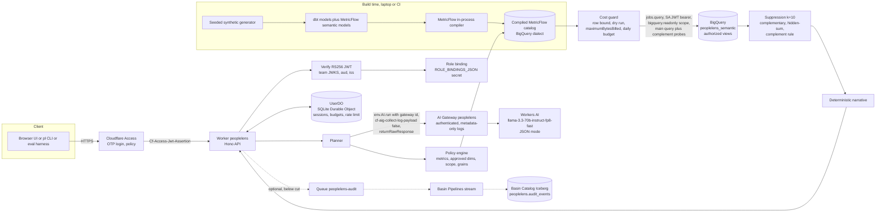
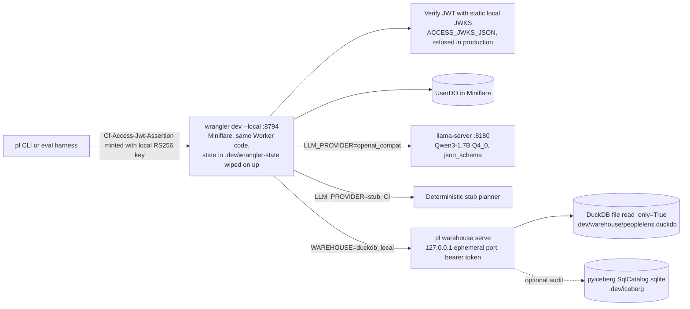

# PeopleLens v1 Specification

Status: architecture spec for a from-scratch v1 build. Written 2026-10-10, revised the same day after review round 1 (section 24). Nothing else exists in the repo yet.
Owner: Nitish (github.com/nitishsjsucs/peoplelens). The builder works locally, commits, and never pushes.

This document is the contract for the build. Every number in the resume text below must be implemented and either asserted by a test or measured by an eval. Where a fact about a package, CLI, or cloud API was checked on 2026-10-10, the check is recorded in section 23 (Verification log). Anything marked **UNVERIFIED** (or **U** in section 17) must be confirmed before it is relied on, and each such step has a doctor check that names it when it fails.

## 0. Acceptance criteria (the resume text)

> PeopleLens: Governed AI Workforce Analytics Agent. Built a privacy-aware analytics agent that translated natural-language workforce questions into governed MetricFlow queries over BigQuery. Used Cloudflare Workers, Workers AI, and AI Gateway to support conversational analytics, clarification questions, controlled access, and AI observability.
> 1. Six governed workforce metrics (headcount, FTE, turnover, offer acceptance, time-to-fill, compensation summaries) using Cloudflare Workers, Workers AI, MetricFlow, and BigQuery.
> 2. Server-enforced safeguards covering four stakeholder roles, including read-only tools, approved query dimensions, query-cost limits, suppression of cohorts smaller than 10 employees, and metadata-only AI Gateway logging.
> 3. An evaluation harness of approximately 200 workforce questions and adversarial cases, comparing semantic-layer queries with direct text-to-SQL, targeting 90% result accuracy and p95 response latency below five seconds.

Numbers that must be true: **6** metrics, **4** roles, cohort threshold **10**, **200** eval items (exactly, so "approximately 200" is true), accuracy target **0.90** and p95 target **5000 ms** (measured, not asserted).

## 1. Goals and non-goals

### Goals
1. A Cloudflare Worker that turns a natural-language workforce question into a structured query intent with one LLM call, validates it against a role policy, and executes only SQL that MetricFlow generated from the governed semantic layer.
2. Exactly six governed metrics, four roles, server-side enforcement of approved dimensions, read-only tools, query-cost limits, k=10 cohort suppression (plus complementary, hidden-sum and complement-filter rules, section 9.5), and metadata-only AI Gateway logging.
3. Conversational behavior: multi-turn sessions (follow-ups modify the previous intent) and clarification questions with selectable options.
4. Two complete paths:
   - **Local** (offline and CI): wrangler dev / Miniflare, DuckDB via dbt-duckdb, a local DuckDB HTTP sidecar, llama-server (Qwen3-1.7B) or a deterministic stub LLM, locally generated RS256 keys for Access JWT verification, pyiceberg local SQL catalog for the optional audit table.
   - **Production** (ready the moment credentials exist): Workers + Durable Objects, Workers AI through AI Gateway, Cloudflare Access, BigQuery with authorized views, policy tags, data masking, and time-travel settings; idempotent bootstrap and a doctor command.
5. An eval harness of exactly 200 items that measures semantic-path accuracy, text-to-SQL baseline accuracy, safety, and latency, and writes reproducible reports.
6. A README that always states what runs where and only reports numbers produced by this repo's scripts (command plus date).

### Non-goals
- No raw SQL path for users, ever. The text-to-SQL baseline exists only inside the eval harness.
- No row-level (per-employee) answers. Every answer is an aggregate.
- No real HR data. All data is synthetic and seeded.
- No sensitive-attribute analytics (gender, date of birth) in v1. They exist in raw data only to demonstrate policy tags and masking, and to drive adversarial evals.
- No Cloudflare Workflows. Nothing in this product is a long-running durable multi-step process; the eval runs from the harness. Recorded as a deliberate exclusion, and the README says "Cloudflare Workflows: not used". Queues, R2 and Basin are listed in the README as used only if the optional audit trail is actually built.
- No dbt Cloud Semantic Layer API (paid dbt Cloud plan). MetricFlow runs open source at build time.
- No differential privacy and no query auditing. Cell suppression plus the complement rule is the disclosure control; residual multi-query differencing risk is documented (sections 9.5 and 22).
- Scope stop-loss: if the build runs long, cut in this order and say so in the README: (1) masking demo, (2) time-travel recovery drill, (3) web UI, (4) audit trail, (5) governance phase C of the bootstrap (kept as documented, unexercised code). Doctor and the phased bootstrap phases A and B are never cut.

## 2. Key design decisions

| Decision | Choice | Why |
|---|---|---|
| How the Worker runs MetricFlow | **Compile-ahead query catalog.** At build time, MetricFlow (Python, in-process API) renders SQL for every allowed (metric, group-by set, grain) shape, in both DuckDB and BigQuery dialects, with named parameters for filters, scope, and time range. The Worker binds parameters and executes. | MetricFlow is Python and cannot run inside a Worker. Every executed query is still MetricFlow output from the governed semantic layer; the LLM never writes SQL. Verified: MetricFlow passes `@name` / `$name` parameters and `IN UNNEST(@x)` through unchanged, and renders BigQuery SQL with no Google credentials (section 23). |
| LLM role | One structured "planner" call producing a JSON intent. The LLM never sees query results; narratives are deterministic templates. | Privacy (results never enter AI Gateway payloads), latency (one call), testability. |
| Filters | Array parameters with an `'__all__'` sentinel, never NULL. | BigQuery docs state a query parameter value cannot be NULL. |
| Percentiles | `use_approximate_percentile: true` in both dialects. Gold stores the lower and upper middle values of each cohort; a median passes if it lies in [lower x 0.99, upper x 1.01]. | Verified: MetricFlow refuses exact percentiles on BigQuery ("Only approximate continous percentile aggregations are supported for BigQuery"). DuckDB renders `approx_quantile`, BigQuery `APPROX_QUANTILES(x, 2)[OFFSET(1)]` (re-rendered 2026-10-10). BigQuery's form returns one input value, not the mean of the two middle values, so a plain 2% tolerance would fail even cohorts in production while passing locally. |
| How dbt is invoked | Only through `pl dbt --dialect <duckdb or bigquery_compile or bigquery> <args>`, which creates `.dev/warehouse/`, sets `--project-dir`, the dialect's committed profiles dir (each with its own default target) and `PL_DUCKDB_PATH`. | dbt-duckdb does not create parent directories (reproduced: "IO Error: Cannot open file ... No such file or directory"), and MetricFlow's `CLIConfiguration` uses the profile's default target and always reads `<project>/target/semantic_manifest.json` (section 8). |
| Local Worker runtime | `ai` binding declared only under `env.production`; local runs use `wrangler dev --local`. | Reproduced with wrangler 4.149.0: a top-level `ai` binding makes `wrangler dev` start a remote proxy and fail in CI ("In a non-interactive environment, it's necessary to set a CLOUDFLARE_API_TOKEN"); on a Mac it asks for a browser login. With either fix it starts offline in about a second. |
| Local warehouse transport | Python sidecar (`pl warehouse serve`) on 127.0.0.1 with an **ephemeral port** and a bearer token, URL injected into wrangler dev. | DuckDB cannot run inside workerd. Ephemeral port avoids collisions with the three repos building in parallel. |
| Session state | One SQLite-backed Durable Object per user (`UserDO`): sessions, pending clarifications, daily byte budget, rate limit. | Verified: SQLite DOs are available on Workers Free and Paid, and work under @cloudflare/vitest-plugin. |
| Agents SDK (`agents`) | Not used. Plain `DurableObject` from `cloudflare:workers` plus Hono. | `agents` moved 0.27.0 (2026-10-07) to 0.28.0 (2026-10-09) in two days and carries ~19 peer deps; the product needs one DO class. |
| Account-specific config | Secrets, not committed IDs, shipped together with the code by `wrangler deploy --env production --secrets-file <tmp json>`. | Repo stays generic and public; production `wrangler.jsonc` needs no IDs. `--secrets-file` exists in 4.149.0 and is additive (omitted secrets are kept). |
| Cloud resource creation | Phased, idempotent bootstrap (A: warehouse, gateway, first deploy that fails closed; B: Access and identities; C: governance) using the gcloud/bq CLIs, wrangler (OAuth) and a custom Cloudflare API token for AI Gateway and Access. | Removes the ACCESS_AUD before-deploy cycle; wrangler's OAuth login has no AI Gateway or Access scopes (verified); governance steps can fail without blocking the resume-critical path. |

## 3. Architecture

### 3.1 Production



BigQuery datasets: `peoplelens_raw` (seeds, PII columns policy-tagged after bootstrap phase C, 48 h time travel), `peoplelens_staging` (views), `peoplelens_core` (tables, compensation column policy-tagged after phase C), `peoplelens_semantic` (authorized views over core plus the time spine table). The Worker service account can read only `peoplelens_semantic`, plus fine-grained read on the compensation policy tag once phase C exists.

The production Worker is named `peoplelens` (`env.production.name` is set explicitly; without it wrangler 4.149.0 deploys `peoplelens-production`) and is served at `https://peoplelens.<workers-subdomain>.workers.dev`.

### 3.2 Local (offline, CI)



### 3.3 Request lifecycle (`POST /api/ask`)
1. **Authenticate**: read `Cf-Access-Jwt-Assertion`; verify RS256 signature against JWKS (remote team certs in production, static JWKS locally), `aud`, `iss`, `exp`. Missing or invalid: 401. Never trust `Cf-Access-Authenticated-User-Email` alone.
2. **Authorize**: map identity through `ROLE_BINDINGS_JSON` to `{role, scope}`. Users bind as `email:<lowercased email>`; service tokens bind as `svc:<common_name>` (the client id, `<hex>.access`), only when the JWT has `type === "app"` and an empty `sub`. No binding: 403 `NO_ROLE_BINDING` (default deny).
3. **Rate limit**: `UserDO.reserveQuestion()` (30 per minute per user).
4. **Plan**: build planner input from the question, the role's allowed metrics, dimensions and values, resolved time hints, and the session's previous intent. One LLM call returns `PlannerOutput` JSON. Invalid JSON or schema: one retry, then a clarification ("Could you rephrase?").
5. **Validate**: policy engine checks metric, dimensions, filter values, number of restricted dimensions, grain, time range, scope. Violations become a refusal or a policy-aware clarification (for example "Monthly is not available to your role. Show quarterly?").
6. **Resolve**: look up catalog entry by key `metric|sorted(group_by)|grain`. Bind parameters (time range, filters, scope). Replace the project placeholder. Build the complement probes (section 9.5 rule 4): the same entry with each restricted dimension widened to `'__all__'`.
7. **Cost guard**: row-count upper bound from dimension cardinalities; dry run (BigQuery `dryRun:true`, local estimator) against the role's per-query cap; reserve bytes for the main query plus probes against the daily budget in `UserDO`; execute with `maximumBytesBilled` set to the role cap.
8. **Execute**: main query and probes in parallel; the warehouse returns rows including the cohort column. Probe results never leave the Worker.
9. **Suppress**: primary (cohort < 10), complementary, hidden-sum, and complement rules (section 9.5); cohort counts are never returned.
10. **Answer**: deterministic narrative plus table; record session turn; emit metadata-only audit event (optional pipeline); return `meta` with timings, bytes, catalog key, provider, `gateway_log_id`.

## 4. Repository layout (exact)

```
peoplelens/
  README.md
  SPEC.md
  LICENSE                                  MIT
  .gitignore                               .dev/ .dev.vars .secrets/ .wrangler/ node_modules/ web/dist/ target/ logs/ dbt_packages/ *.duckdb
  .gitattributes                           *.csv -text, SHA256SUMS -text (csv module writes \r\n; git must not normalize)
  .nvmrc                                   24
  .python-version                          3.12
  Makefile                                 thin wrappers over pl, pl-ops, npm
  package.json                             npm workspaces ["worker","web"]; scripts below
  package-lock.json
  pyproject.toml                           package "peoplelens"; scripts pl, pl-ops, pl-eval
  uv.lock
  .github/workflows/ci.yml
  policy/
    metrics.json                           the 6 governed metrics
    dimensions.json                        the 5 approved dimensions, aliases, display order
    roles.json                             the 4 roles
    limits.json                            k=10, row cap, max restricted dims, byte caps, budgets, rate limits
    role_bindings.local.json               example.test identities, local and CI only
  warehouse/
    dbt/
      dbt_project.yml                      vars: apply_policy_tags (default false)
      profiles/
        duckdb/profiles.yml                default target duckdb; path "{{ env_var('PL_DUCKDB_PATH') }}" (no default)
        bigquery_compile/profiles.yml      default target bigquery_compile; project peoplelens-project-id, method oauth, offline render only
        bigquery/profiles.yml              default target bigquery; project "{{ env_var('GCP_PROJECT_ID') }}", method oauth (ADC)
      macros/
        generate_schema_name.sql           exact schema names; bigquery prefixes dataset "peoplelens_"
        pl_time.sql                        cast to timestamp on bigquery, date on duckdb
        pl_days_between.sql                dbt.datediff wrapper
        pl_bq_config.sql                   bigquery-only configs (grant_access_to, policy tags) as no-ops on duckdb
      seeds/
        raw_employees.csv
        raw_job_history.csv
        raw_compensation_history.csv
        raw_requisitions.csv
        raw_offers.csv
        raw_candidates.csv
        _seeds.yml                         column types, policy_tags (bigquery), persist_docs
        SHA256SUMS                         determinism check
      models/
        staging/  stg_employees.sql stg_job_history.sql stg_compensation.sql stg_requisitions.sql stg_offers.sql _staging.yml
        core/     dim_month.sql dim_employee.sql fct_workforce_monthly.sql fct_requisitions.sql fct_offers.sql _core.yml
        semantic/ sem_workforce_monthly.sql sem_requisitions.sql sem_offers.sql metricflow_time_spine.sql
                  _semantic_models.yml _metrics.yml _semantic.yml (includes the `time_spine:` YAML config)
      tests/                               singular tests, one per exact count (section 5.3)
    bigquery/
      governance/
        01_datasets.sql                    CREATE SCHEMA IF NOT EXISTS ... OPTIONS(location, max_time_travel_hours)
        02_dataset_grants.sql              GRANT roles ON SCHEMA ... TO service accounts
        taxonomy.json                      policy tags, data policies, readers (input to bootstrap)
      recovery/
        time_travel_restore.sql            FOR SYSTEM_TIME AS OF restore into a new table
        RUNBOOK.md                         time travel window, fail-safe, bq cp @epoch restore
  src/peoplelens/
    __init__.py
    paths.py
    cli.py                                 `pl` entry point
    dbt_runner.py                          `pl dbt` and `pl mf validate` wrappers (mkdir, profiles dir per dialect, PL_DUCKDB_PATH)
    synth/      spec.py generator.py names.py
    reference/  metrics.py                 independent pure-Python metric implementation (gold)
    catalog/    compiler.py keys.py params.py dims.py manifest_guard.py
    warehouse/  server.py cost.py audit_sink.py
    dev/        orchestrator.py keys.py tokens.py llm.py procs.py (process groups, port checks)
    eval/       templates.py generate.py runner.py pacing.py compare.py baseline.py llm_client.py report.py
    ops/        cli.py doctor.py cloudflare_api.py bootstrap_gcp.py bootstrap_cloudflare.py bootstrap_access.py
                bootstrap_governance.py smoke.py roles.py checks.py
  tests/py/
    conftest.py                            `require_warehouse` fixture: skip locally if the DuckDB file is missing, fail when CI or PL_STRICT is set
    test_synth_counts.py test_synth_determinism.py test_reference_fixtures.py
    test_semantic_parity.py test_dbt_counts.py test_catalog_compile.py test_catalog_bigquery_offline.py
    test_catalog_manifest_guard.py test_dbt_runner.py
    test_params_contract.py test_warehouse_server.py test_cost_estimator.py
    test_eval_set.py test_compare.py test_baseline_guard.py test_policy_files.py test_pacing.py
    test_doctor.py test_bootstrap_plan.py test_cloudflare_api.py test_audit_sink.py
  worker/
    package.json
    wrangler.jsonc                         local (top level) and env.production (section 10.1)
    tsconfig.json                          strict, noUncheckedIndexedAccess, exactOptionalPropertyTypes; types: @cloudflare/workers-types
    vitest.config.ts                       cloudflareTest({ remoteBindings: false, wrangler: { configPath } })
    src/
      index.ts                             Hono app, routes, queue() handler (optional audit)
      env.ts                               hand-written Env type (no `wrangler types` output is committed), startup config validation, production guards
      log.ts                               whitelisted structured logging (no question text, no results)
      auth/access.ts auth/principal.ts
      policy/types.ts policy/policy.ts policy/validate.ts
      planner/planner.ts planner/prompt.ts planner/schema.ts planner/timephrases.ts planner/values.ts
      llm/types.ts llm/workersAi.ts llm/openaiCompat.ts llm/stub.ts
      catalog/catalog.ts catalog/bind.ts
      warehouse/types.ts warehouse/bigquery.ts warehouse/googleAuth.ts warehouse/localDuckdb.ts
      guard/cost.ts guard/suppression.ts guard/complement.ts
      session/userDO.ts
      answer/narrative.ts
      tools/registry.ts
      audit/audit.ts
      generated/                           written by `pl catalog build`, committed, drift-checked in CI
        catalog.duckdb.json catalog.bigquery.json dimension_values.json policy.json fewshot.json
    test/
      helpers/keys.ts helpers/fakeWarehouse.ts helpers/fakeAi.ts
      access.test.ts principal.test.ts policy.matrix.test.ts validate.test.ts
      catalog.test.ts bind.test.ts suppression.test.ts suppression.property.test.ts complement.test.ts
      cost.test.ts bigquery.test.ts googleAuth.test.ts planner.test.ts timephrases.test.ts
      llm.workersAi.test.ts llm.openaiCompat.test.ts tools.test.ts session.test.ts
      api.test.ts fuzz.safety.test.ts logging.test.ts prodConfig.test.ts bindings.test.ts audit.test.ts
  web/                                     below the core cut line
    package.json index.html vite.config.ts tsconfig.json
    src/main.tsx src/App.tsx src/api.ts src/ResultTable.tsx src/Clarification.tsx
  eval/
    templates/answerable.yaml              eval-only templates (ids T-*)
    templates/dev.yaml                     dev-only templates (ids D-*), disjoint from eval
    handwritten/clarification.yaml         20 items
    handwritten/adversarial.yaml           30 items (34 turns: 4 are two-turn differencing probes)
    questions.jsonl                        exactly 200, generated then frozen
    dev_questions.jsonl                    exactly 60, used for few-shot and prompt work only
    gold.json                              gold results from reference implementation, drift-checked
    results/                               committed run outputs: <date>-<target>-<model>.json and .md
  infra/cloudflare/
    audit_stream_schema.json               below the core cut line
```

Root `package.json` scripts: `test` (vitest in worker), `typecheck`, `build:web`, `dev` (`uv run pl dev up`), `doctor` (`uv run pl-ops doctor`), `setup:prod` (`uv run pl-ops bootstrap`, all phases, resumable), `deploy:prod` (`uv run pl-ops deploy`).

Gitignored secrets directory `.secrets/` (mode 0700, files 0600, doctor warns on wider modes): `cloudflare.env` (account id, API token, optional `BASIN_CATALOG_TOKEN`), `prod_eval.env` (four service-token client ids and secrets), `peoplelens-eval.json` (eval SA key), `bootstrap-state.json` (resource ids, no secrets). The Worker SA key exists on disk only between `gcloud ... keys create` and the deploy that uploads it.

Makefile targets: `setup`, `data`, `dbt`, `catalog`, `test`, `dev-up`, `dev-down`, `llm-up`, `llm-down`, `eval-local`, `eval-stub`, `doctor`, `bootstrap`, `deploy`, `smoke`, `eval-prod`. Makefile must work with GNU make on ubuntu-latest and BSD make is not required (document `make` = GNU make via Xcode CLT, which is GNU make 3.81; avoid features newer than 3.81).

## 5. Data model and synthetic generator

### 5.1 Fictional company and window
- Company: "Lumen Works" (fictional). Email domain `lumenworks.example` (reserved TLD).
- Analysis window: 2023-01-01 to 2025-12-31 (36 months). As-of date for "now": **2025-12-31**. The planner prompt states this date; results never depend on the wall clock.
- Seed: `SEED = 20231` (constant in `synth/spec.py`). Generator uses only `random.Random(SEED)`, sorted iteration, fixed float formatting, and no hash-ordered containers. Output CSVs are byte-identical on macOS and Linux; `SHA256SUMS` is committed and CI regenerates and compares. Python's `csv` module writes `\r\n`, so `.gitattributes` marks `*.csv` and `SHA256SUMS` as `-text`; without it git line-ending normalization would break `pl data generate --check` on a checkout.

### 5.2 Raw tables (seeds)

| Table | Rows | Columns |
|---|---|---|
| raw_employees | **2,400** | employee_id (E00001..E02400), full_name, work_email, date_of_birth, gender, hire_date, termination_date, termination_type (voluntary, involuntary, empty), employment_type (full_time, part_time), fte (1.0, 0.8, 0.5) |
| raw_job_history | 2,400 + 300 promotions + 120 transfers = **2,820** | employee_id, effective_date, end_date, department, location, job_level, job_family, change_reason (hire, promotion, transfer) |
| raw_compensation_history | pinned after first run (see note) | employee_id, effective_date, base_salary_usd, change_reason (hire, merit, promotion) |
| raw_requisitions | **1,050** | requisition_id, department, location, job_level, opened_date, status (filled, open, cancelled), filled_date, closed_date |
| raw_offers | **1,080** | offer_id, requisition_id, candidate_id, offer_date, decision (accepted, declined), decision_date, hired_employee_id |
| raw_candidates | **1,080** | candidate_id, full_name, email |

Note on compensation rows: one hire row per employee, one merit row each April 1 for employees active at least 6 months, one row per promotion. The resulting exact count is printed by `pl data stats` on the first deterministic run and pinned in `tests/py/test_synth_counts.py`; it may change only with a deliberate commit that also updates the pin.

### 5.3 Exact counts (asserted by pytest on CSVs and by dbt singular tests on marts)

| Quantity | Exact value |
|---|---|
| Employees ever employed in dataset | 2,400 |
| Active on 2023-01-01 (opening headcount) | 1,500 |
| Hires in window | 900 (2023: 280, 2024: 300, 2025: 320) |
| Terminations in window | 620 (2023: 190, 2024: 210, 2025: 220); voluntary 450, involuntary 170 |
| Active on 2025-12-31 (closing headcount) | 1,780 = 1,500 + 900 - 620 |
| Closing part-time | 160 (80 at 0.5 FTE, 80 at 0.8 FTE) |
| Closing FTE | 1,724.0 = 1,620 + 40 + 64 |
| Closing headcount by department | Engineering 620, Sales 380, Customer Success 250, Marketing 150, Finance 120, People 90, Operations 162, **Legal 8** (sum 1,780) |
| Closing headcount by location | San Jose 700, New York 420, Austin 300, London 220, Bengaluru 140 (sum 1,780) |
| Closing headcount by job level | L1 300, L2 520, L3 480, L4 290, L5 140, L6 50 (sum 1,780) |
| Promotions in window / department transfers in window | 300 / 120 |
| Requisitions (opened 2022-09-01 to 2025-12-31) | 1,050: filled 900, open at 2025-12-31 90, cancelled 60 |
| Offers extended / accepted / declined | 1,080 / 900 / 180 (one candidate per offer) |
| Each window hire fills exactly one requisition | 900 filled requisitions map 1:1 to 900 hires |

Legal (8 at close) and several department by location by level cells are deliberately below 10 so suppression is exercised on real queries.

The generator constructs the end state first (who is active on 2025-12-31 and with which attributes, satisfying every marginal above), then back-fills hire dates, terminations, promotions and transfers so that every count holds by construction. `synth/spec.py` holds every constant; tests import them, so a number appears once.

### 5.4 dbt layers
- **staging** (views): drop PII (`full_name`, `work_email`, `date_of_birth`, `gender`, candidate name and email), cast types.
- **core** (tables):
  - `dim_month`: 36 rows, month_start, month_end.
  - `dim_employee`: employee_id, hire_date, termination_date, termination_type, employment_type, fte.
  - `fct_workforce_monthly`: one row per employee per month in which the employee was employed at any point. Columns: employee_id, month_start (pl_time), department, location, job_level, job_family, employment_type, tenure_band (`<1y`, `1-2y`, `2-5y`, `5y+` at month end), is_active_eom (0/1), fte_eom, is_termination (0/1, terminated in that month), is_voluntary_termination, base_salary_eom (policy-tagged on BigQuery).
  - `fct_requisitions`: requisition_id, department, location, job_level, opened_date, filled_date, status, days_to_fill.
  - `fct_offers`: offer_id, requisition_id, department, location, job_level, offer_date, is_accepted.
- **semantic** (BigQuery: authorized views via dbt-bigquery `grant_access_to` on `peoplelens_core`; DuckDB: plain views): `sem_workforce_monthly`, `sem_requisitions`, `sem_offers`, plus `metricflow_time_spine` (table, day grain, 2019-01-01 to 2026-12-31) declared with the `time_spine:` YAML config (`standard_granularity_column: date_day`). dbt-core 1.12.5 raises `MFTimespineWithoutYamlConfigurationDeprecation` for the legacy form without YAML (verified in its `deprecations.py`).
- Time columns go through `pl_time()`: TIMESTAMP on BigQuery, DATE on DuckDB. Reason: MetricFlow renders `TIMESTAMP_TRUNC(col, month)` for BigQuery (verified); feeding it a DATE column is **UNVERIFIED**, so BigQuery columns are TIMESTAMP and the prod smoke dry-runs every catalog entry.
- dbt tests: `unique`/`not_null` on keys, `accepted_values` on every dimension, `relationships` from facts to `dim_employee`, plus singular tests: `assert_total_employees_2400`, `assert_opening_headcount_1500`, `assert_hires_900`, `assert_terminations_620_vol_450`, `assert_closing_headcount_1780`, `assert_closing_fte_1724`, `assert_closing_by_department`, `assert_closing_by_location`, `assert_closing_by_level`, `assert_legal_closing_8`, `assert_requisitions_1050`, `assert_offers_1080_accepted_900`. Tests use dbt cross-database macros so they run on both adapters.
- BigQuery-only configs: dataset labels and, only when the dbt var `apply_policy_tags` is true (bootstrap phase C sets it after the taxonomy and fine-grained reader grants exist; default false), `persist_docs: {columns: true}` with `policy_tags` (dbt docs: column-level persist_docs is required for policy tags; verified). Tag mapping, chosen so every masking rule fits its column type: `pii_high` (SHA256, STRING only) on `raw_employees.full_name`, `raw_employees.work_email`, `raw_candidates.full_name`, `raw_candidates.email`; `protected_class` (ALWAYS_NULL, any type) on `raw_employees.date_of_birth` (DATE) and `raw_employees.gender`; `compensation` (DEFAULT_MASKING_VALUE) on `raw_compensation_history.base_salary_usd` and `fct_workforce_monthly.base_salary_eom`. A test asserts no SHA256-tagged column is not STRING.

## 6. Semantic layer and the six governed metrics

MetricFlow semantic models (in `_semantic_models.yml`):
- `workforce` on `sem_workforce_monthly`; primary entity `workforce` (expr employee_id plus month), agg time dimension `month_start` (month grain). Dimensions: department, location, job_level, employment_type, tenure_band.
- `requisitions` on `sem_requisitions`; primary entity `requisition`; agg time dimension `filled_date` (day). Dimensions: department, location, job_level.
- `offers` on `sem_offers`; primary entity `offer`; agg time dimension `offer_date` (day). Dimensions: department, location, job_level.

Governed metrics (`policy/metrics.json` maps each governed id to MetricFlow metrics, cohort metric, unit, comparator tolerance):

| # | Governed id | MetricFlow metrics returned | Definition | Cohort metric (suppression) | Unit | Tolerance |
|---|---|---|---|---|---|---|
| 1 | headcount | `headcount` | Sum of is_active_eom at the last month-end in each bucket (non_additive_dimension month_start, window_choice max) | `headcount` itself | employees | exact |
| 2 | fte | `fte` | Sum of fte_eom for actives at last month-end in bucket (non-additive) | `cohort_employees` (= headcount) | FTE | abs 1e-6 |
| 3 | turnover_rate | `turnover_rate` (derived) | terminations / (employee_months / snapshot_months), not annualized | `avg_headcount` (= employee_months / snapshot_months) | ratio | rel 1e-6 |
| 4 | offer_acceptance_rate | `offer_acceptance_rate` (ratio) | accepted offers / extended offers by offer_date | `offers_extended` | ratio | rel 1e-6 |
| 5 | time_to_fill_days | `time_to_fill_days` | Average days from opened_date to filled_date for requisitions filled in bucket | `filled_requisitions` | days | rel 1e-6 |
| 6 | compensation_summary | `avg_base_salary`, `median_base_salary` | Average and approximate median base_salary_eom for actives at last month-end (non-additive) | `cohort_employees` | USD | avg rel 1e-6; median within [lower middle x 0.99, upper middle x 1.01] |

Verified in a scratch project (section 23): non-additive measures with average and approximate percentile aggregations, derived turnover metric, and where-filters with named parameters all render for DuckDB and BigQuery and execute on DuckDB.

Measure expressions (fixed up front, mirrored exactly by `reference/metrics.py`). `fct_workforce_monthly` has a row for everyone employed at any point in the month, including people who left during it, and the rendered non-additive SQL takes `MAX(month_start)` over the whole filtered set. So every stock measure must gate on `is_active_eom` itself:
- `headcount`, `cohort_employees`: `SUM(is_active_eom)`.
- `fte`: `SUM(CASE WHEN is_active_eom = 1 THEN fte_eom ELSE 0 END)`.
- `avg_base_salary`, `median_base_salary`: `expr: CASE WHEN is_active_eom = 1 THEN base_salary_eom END` (AVG and the approximate quantile ignore NULL).
- `employee_months`: `SUM(is_active_eom)` without the non-additive dimension; `snapshot_months`: `COUNT(DISTINCT month_start)`; `terminations`: `SUM(is_termination)`.
All three stock metrics use `non_additive_dimension: {name: month_start, window_choice: max}` with no window groupings, so every group in a result shares the same last month.

Defaults when the user gives no period (stated to the planner and enforced server-side): stock metrics (headcount, fte, compensation_summary) use grain `none` over 2025-12-01..2025-12-31 (the latest month-end); flow metrics (turnover_rate, offer_acceptance_rate, time_to_fill_days) use grain `none` over 2025-01-01..2025-12-31.

## 7. Governance policy (exact contents)

### 7.1 `policy/dimensions.json`
Five approved dimensions: `department` (8 values), `location` (5), `job_level` (L1..L6), `employment_type` (full_time, part_time), `tenure_band` (4). Each has display name, aliases (for example "SJ" and "San Jose HQ" to San Jose, "Bangalore" to Bengaluru, "eng" to Engineering, "CS" to Customer Success), and per-metric MetricFlow names (`workforce__department`, `requisition__department`, `offer__department`, ...). Recruiting metrics support only department, location, job_level.

Not approved anywhere: gender, date_of_birth or age, names, emails, employee_id, candidate_id, job_family, manager. Requests for them are refused with `DIMENSION_NOT_APPROVED` or `PII_REQUEST`.

### 7.2 `policy/roles.json` (exactly four roles)

| Role id | Metrics | Approved dimensions | Grains | Scope |
|---|---|---|---|---|
| people_analytics | all 6 | department, location, job_level, employment_type, tenure_band | none, month, quarter, year | all |
| hr_business_partner | headcount, fte, turnover_rate, compensation_summary | department, location, job_level, tenure_band | none, month, quarter, year | assigned departments from role binding |
| talent_acquisition | headcount, offer_acceptance_rate, time_to_fill_days | department, location, job_level | none, month, quarter, year | all |
| executive | all 6 | department, location | none, quarter, year | all |

### 7.3 `policy/limits.json`
- `min_cohort`: **10** (single constant; vitest and pytest both assert it).
- `max_group_by`: 2 (excluding time).
- `max_restricted_dimensions`: 2. A dimension is restricted when a filter or the HRBP scope selects a proper subset of its values; the HRBP scope and any department filter merge into one restricted `department`. This caps complement probes at 3 per question (section 9.5).
- `max_rows`: 500 (upper bound computed from cardinalities times time buckets; rejected before execution with `RESULT_TOO_LARGE` and a suggestion).
- `max_range_months`: 36.
- Per-query byte cap (`maximumBytesBilled` and dry-run cap): 200 MiB people_analytics, 100 MiB others. Real queries bill BigQuery's 10 MB minimum per referenced table, so this cap is a backstop that normal queries never reach; `pl-ops smoke` proves BigQuery enforces the field by running one entry with a 1 MiB cap (section 17.8).
- Daily byte budget per user: 5 GiB (about 100 to 250 questions at the 10 MB minimum, depending on complement probes; covers a full prod eval per identity). Local runs start from a fresh Miniflare state on every `pl dev up`, so repeated local evals in one day do not exhaust it.
- Rate limit: 30 questions per minute per user (UserDO); AI Gateway gateway-level rate limit 120 requests per minute. The eval runner paces itself to at most 25 requests per minute per identity, so evals exercise the same limits as users and never see `RATE_LIMITED`.

### 7.4 Refusal and violation codes
`UNAUTHENTICATED`, `NO_ROLE_BINDING`, `METRIC_NOT_ALLOWED`, `DIMENSION_NOT_APPROVED`, `PII_REQUEST`, `WRITE_REQUEST`, `SCOPE_VIOLATION`, `GRAIN_NOT_ALLOWED`, `TIME_RANGE_INVALID`, `RESULT_TOO_LARGE`, `COST_LIMIT_EXCEEDED`, `DAILY_BUDGET_EXCEEDED`, `RATE_LIMITED`, `OUT_OF_DOMAIN`, `PLANNER_INVALID_OUTPUT`.

## 8. Query catalog compiler (`pl catalog build`)

Input: the dbt project, `policy/*.json`, dimension value catalog (queried from local DuckDB once; values are non-PII labels).

How MetricFlow is driven (checked against dbt-metricflow 0.15.0 source on 2026-10-10): `CLIConfiguration.setup()` accepts only `dbt_profiles_path`, `dbt_project_path` and `configure_file_logging`; it loads the profile's **default target** (there is no target override and `DBT_TARGET` is ignored), and it always reads `<dbt_project_path>/target/semantic_manifest.json`, whatever `--target-path` the last `dbt parse` used. With a stale manifest it does not always fail: a BigQuery-parsed manifest plus the DuckDB profile rendered DuckDB SQL against `` `peoplelens-project-id` `` relations without any error. Therefore:

1. `pl catalog build` compiles **BigQuery first, then DuckDB**, each in its own subprocess, so `target/` ends in the DuckDB state that `mf` dev commands expect. `--check` does the same work and diffs, so it never depends on what ran before it.
2. Per dialect: run `dbt parse --no-partial-parse --project-dir warehouse/dbt --profiles-dir warehouse/dbt/profiles/<dialect>` (through `pl dbt`), then `CLIConfiguration().setup(dbt_profiles_path=warehouse/dbt/profiles/<dialect>, dbt_project_path=warehouse/dbt, configure_file_logging=False)`.
3. `manifest_guard.py` then asserts, before any SQL is rendered, that `cfg.dbt_artifacts.adapter.type()` is the expected adapter and that every semantic model's `node_relation.database` is the expected value (`peoplelens-project-id` for BigQuery, `peoplelens` for DuckDB). On mismatch it stops with the exact `pl dbt` command to rerun. The manifest's sha256 is recorded in the catalog header.
4. Render with `cfg.mf.explain(MetricFlowQueryRequest.create(...)).sql_statement.sql` (verified at about 8 ms per query after a ~10 s setup).

- Shapes: for each governed metric, every group-by subset of its approved dimension union of size 0 to 2, times grains {none, month, quarter, year}. Workforce metrics: 4 metrics x 16 subsets x 4 grains = 256. Recruiting: 2 x 7 x 4 = 56. **312 entries per dialect.** Measured SQL size ~2.7 KB per entry, so ~0.85 MB per dialect, far under the Worker size limit (64 MiB uncompressed; the official limits page states there is no compressed size limit). The production bundle imports only the BigQuery catalog and the local build only the DuckDB catalog (a build-time alias), which keeps global-scope parse time well inside the 1 s startup limit.
- Every entry includes the cohort metric(s) alongside the governed metric(s).
- Where-filters (dialect-specific strings, verified to pass through MetricFlow unchanged):
  - BigQuery: `('__all__' IN UNNEST(@f_<dim>) OR {{ Dimension('<entity>__<dim>') }} IN UNNEST(@f_<dim>))` for each approved dimension of the metric; `{{ Dimension('<entity>__department') }} IN UNNEST(@scope_departments)`; `{{ TimeDimension('metric_time', '<month|day>') }} BETWEEN @start_ts AND @end_ts`.
  - DuckDB: same with `list_contains($f_<dim>, '__all__') OR list_contains($f_<dim>, ...)`, `list_contains($scope_departments, ...)`, `BETWEEN $start_ts AND $end_ts`.
- Parameter contract per entry: `start_ts`, `end_ts` (TIMESTAMP on BigQuery, DATE on DuckDB), one `f_<dim>` ARRAY<STRING> per approved dimension of the metric (`['__all__']` when unfiltered), `scope_departments` ARRAY<STRING> (all departments when unscoped). NULL is never bound.
- BigQuery compile uses the `bigquery_compile` profiles dir (default target `bigquery_compile`, project `peoplelens-project-id`, method oauth, no credentials; re-verified offline on 2026-10-10 with the parse-then-compile sequence above, output contains `TIMESTAMP_TRUNC(..., month)`, `APPROX_QUANTILES(x, 2)[OFFSET(1)]` and `IN UNNEST(@f_location)` unchanged). Offline guard against TIMESTAMP and DATETIME mismatches that only a BigQuery dry run would otherwise catch: `test_catalog_bigquery_offline.py` fails if any BigQuery entry contains `AS DATETIME` (none appeared in the verification render). The Worker replaces the exact token `` `peoplelens-project-id` `` with `` `${GCP_PROJECT_ID}` `` after validating the id against `^[a-z][a-z0-9-]{4,28}[a-z0-9]$`.
- DuckDB SQL references `"peoplelens"."semantic"."sem_*"`; the DuckDB file must be named `peoplelens.duckdb` so the catalog alias matches.
- Comment-only lines are stripped. Each entry stores: key, metric, group_by, grain, MetricFlow metric names, column map (dimension, time, value, cohort), parameter list with types, sql, sha256, row-bound inputs.
- Output: `worker/src/generated/catalog.{duckdb,bigquery}.json`, `dimension_values.json`, `policy.json` (merged copy of `policy/*.json`), `fewshot.json` (from the dev set only). Header records `metricflow`, `dbt-metricflow`, `dbt-core` versions.
- The compiler must not run while the warehouse sidecar holds the DuckDB file: `CLIConfiguration` opens it read-write (observed conflict; a second connection in the same process with a different configuration also fails). `pl catalog build` checks and refuses.
- CI: `pl catalog build --check` regenerates both dialects and fails on any diff or guard failure.
- `pl mf validate` runs `mf validate-configs --skip-dw` with cwd `warehouse/dbt` and `DBT_PROFILES_DIR=warehouse/dbt/profiles/duckdb`, after a DuckDB `dbt parse`.

## 9. Components and interfaces

### 9.1 HTTP API (Worker)

| Route | Auth | Purpose |
|---|---|---|
| `GET /api/health` | none | `{ok, environment, warehouse, llm_provider, catalog_entries}`; no data |
| `GET /api/me` | JWT | principal, role, scope, allowed metrics, dimensions, grains |
| `GET /api/catalog` | JWT | role-filtered metric and dimension catalog (the `list_metrics` tool) |
| `POST /api/sessions` | JWT | create session, returns `session_id` |
| `POST /api/ask` | JWT | `{session_id, message}` or `{session_id, choose_option}` |
| `/*` static UI | Access at edge | below cut line (Workers static assets, `run_worker_first` for `/api/*`) |

`POST /api/ask` response:
```json
{
  "request_id": "uuid",
  "type": "answer | clarification | refusal",
  "answer": {
    "metric": "turnover_rate",
    "intent": { "metric": "turnover_rate", "group_by": ["department"], "grain": "quarter",
                "time_range": { "start": "2024-01-01", "end": "2024-12-31" },
                "filters": [ { "dimension": "location", "values": ["London"] } ] },
    "definition": "Terminations divided by average monthly headcount in the period. Not annualized.",
    "columns": [ { "name": "department", "kind": "dimension" }, { "name": "period", "kind": "time" },
                 { "name": "turnover_rate", "kind": "measure", "unit": "ratio" } ],
    "rows": [ { "department": "Sales", "period": "2024-01-01", "turnover_rate": 0.031, "suppressed": false } ],
    "suppressed_cells": { "primary": 1, "complementary": 1, "hidden_sum": 0, "complement": 0 },
    "narrative": "deterministic template text"
  },
  "clarification": { "question": "...", "options": [ { "id": "o1", "label": "Headcount (people)" } ] },
  "refusal": { "code": "DIMENSION_NOT_APPROVED", "message": "...", "alternatives": ["department", "location"] },
  "meta": { "latency_ms": 0, "llm_ms": 0, "warehouse_ms": 0, "estimated_bytes": 0, "billed_bytes": null,
            "catalog_key": "turnover_rate|department|quarter", "warehouse": "bigquery | duckdb-local | fake",
            "llm_provider": "workers_ai | openai_compat | stub", "model": "string", "gateway_log_id": null }
}
```

### 9.2 TypeScript interfaces (worker/src)
```ts
type MetricId = "headcount" | "fte" | "turnover_rate" | "offer_acceptance_rate" | "time_to_fill_days" | "compensation_summary";
type DimensionId = "department" | "location" | "job_level" | "employment_type" | "tenure_band";
type Grain = "none" | "month" | "quarter" | "year";
type RoleId = "people_analytics" | "hr_business_partner" | "talent_acquisition" | "executive";

interface Principal { subject: string; kind: "user" | "service_token"; role: RoleId; scope: { departments: string[] | "all" } }
interface QueryIntent { metric: MetricId; groupBy: DimensionId[]; grain: Grain; timeRange: { start: string; end: string };
                        filters: { dimension: DimensionId; values: string[] }[] }
type PlannerOutput =
  | { action: "query"; intent: QueryIntent }
  | { action: "clarify"; question: string; options: { id: string; label: string; patch: Partial<QueryIntent> }[] }
  | { action: "refuse"; reason: RefusalCode };

// auth/access.ts
function verifyAccessJwt(token: string, cfg: { aud: string; issuer: string; jwks: JWKSource }): Promise<AccessClaims>;
// auth/principal.ts
function resolvePrincipal(claims: AccessClaims, bindings: RoleBindings): Principal; // throws NO_ROLE_BINDING
// policy/validate.ts
function validateIntent(intent: QueryIntent, p: Principal, policy: Policy, values: DimensionValues): Validated | Violation;
// catalog/catalog.ts, catalog/bind.ts
function catalogKey(v: Validated): string;
function bindQuery(entry: CatalogEntry, v: Validated, p: Principal, dialect: "bigquery" | "duckdb", projectId?: string): BoundQuery;
// warehouse/types.ts
interface Warehouse {
  readonly kind: "bigquery" | "duckdb-local" | "fake";
  dryRun(q: BoundQuery): Promise<{ estimatedBytes: number }>;
  run(q: BoundQuery, o: { maxBytesBilled: number; timeoutMs: number; labels: Record<string, string> }): Promise<ResultSet & { billedBytes: number | null; elapsedMs: number }>;
}
// guard/cost.ts
function rowUpperBound(entry: CatalogEntry, v: Validated, values: DimensionValues): number;
function checkCost(est: number, p: Principal, limits: Limits, budget: BudgetPort): Promise<CostDecision>;
// guard/suppression.ts (pure)
function suppress(rs: ResultSet, spec: { dims: string[]; time?: string; measures: string[]; cohort: string; k: number }): SuppressedResult;
// guard/complement.ts (pure planning plus a pure comparison)
function complementProbes(v: Validated, p: Principal, policy: Policy): ProbeSpec[]; // 0 to 3 widened parameter sets
function applyComplementRule(main: ResultSet, probes: ResultSet[], spec: { keys: string[]; cohort: string; k: number }): { suppressKeys: Set<string> };
// llm/types.ts
interface LlmClient { readonly provider: "workers_ai" | "openai_compat" | "stub"; plan(input: PlannerInput): Promise<{ raw: unknown; usage?: TokenUsage; ms: number; gatewayLogId?: string | null }> }
// tools/registry.ts
interface Tool<I> { name: string; readOnly: true; inputSchema: ZodType<I>; run(i: I, ctx: ToolCtx): Promise<unknown> }
// session/userDO.ts (DurableObject RPC)
class UserDO { reserveQuestion(now: number): Promise<RateDecision>; reserveBytes(day: string, bytes: number, cap: number): Promise<BudgetDecision>;
               settleBytes(day: string, reserved: number, billed: number | null): Promise<void>;
               getSession(id: string): Promise<SessionState | null>; saveTurn(id: string, turn: TurnRecord): Promise<void> }
```

Tools in the registry (all `readOnly: true`, none accepts SQL): `list_metrics`, `describe_metric`, `list_dimension_values`, `run_governed_query` (takes a `QueryIntent`), `ask_clarification`. The planner selects the action; the server invokes tools. A test fails if any tool lacks `readOnly: true` or has an input property named or containing `sql` or `query_text`.

### 9.3 Planner
- Input: system rules, role-filtered metric and dimension catalog with values and aliases, defaults, as-of date 2025-12-31, resolved time hints from `timephrases.ts` (deterministic parsing of "2024", "Q3 2025", "last year", "right now", "YTD"), previous intent and pending clarification, 12 few-shot examples from the dev set, the user message.
- Output JSON schema (`planner/schema.ts`, also emitted as JSON Schema): flat object `{action, metric, group_by, grain, start, end, filters[{dimension, values[]}], clarification_question, clarification_options[], refusal_reason}`; the server maps it into `PlannerOutput` and ignores irrelevant fields.
- Providers:
  - `workers_ai` (production): `const res = await env.AI.run(PLANNER_MODEL, { messages, response_format: { type: "json_schema", json_schema: <schema> }, temperature: 0, max_tokens: 300 }, { gateway: { id: AI_GATEWAY_ID, collectLog: true, metadata: { request_id, role, turn } }, extraHeaders: { "cf-aig-collect-log-payload": "false" }, returnRawResponse: true })`. The gateway log id is read from `res.headers.get("cf-aig-log-id")`, never from `env.AI.aiGatewayLogId`: workerd's ai-api stores both the call options (`this.#options`) and `this.aiGatewayLogId` on the shared binding object, so concurrent requests in one isolate can swap them (verified in the workerd shipped with wrangler 4.149.0). For the same reason every call passes an options object of identical shape built by one function. With `returnRawResponse` the binding does not throw on non-2xx, so the client checks `res.ok`, parses the error body, and maps it. Default `PLANNER_MODEL = @cf/meta/llama-3.3-70b-instruct-fp8-fast` (listed as JSON Mode capable). Handles the documented "JSON Mode couldn't be met" error with one retry.
  - `openai_compat` (local): `POST ${LLM_BASE_URL}/chat/completions` with `response_format: { type: "json_schema", json_schema: { name, schema } }` and `chat_template_kwargs: { enable_thinking: false }` (both verified against llama-server build 11146 with Qwen3-1.7B).
  - `stub` (CI, tests): deterministic keyword planner written only from dev templates. Never reported as model accuracy.
- Metadata sent to AI Gateway never contains question text, emails, or results.

### 9.4 Warehouse clients
- `BigQueryWarehouse`: OAuth2 JWT-bearer flow (RS256 assertion signed with `jose.importPKCS8` from `GCP_SA_KEY_JSON`; `iss` = client_email, `scope` = `https://www.googleapis.com/auth/bigquery.readonly`, `aud` = `https://oauth2.googleapis.com/token`, `exp` <= 1 h; verified) to `https://oauth2.googleapis.com/token`; token cached per isolate until 60 s before expiry. Calls `POST https://bigquery.googleapis.com/bigquery/v2/projects/{GCP_PROJECT_ID}/queries` with `useLegacySql:false`, `parameterMode:"NAMED"`, typed `queryParameters` (`ARRAY<STRING>` via `arrayType` and `arrayValues`), `location:"US"`, `labels:{app:"peoplelens", role, catalog_key_hash}`, `maximumBytesBilled` (string), `timeoutMs: 8000`, `jobTimeoutMs: "15000"`, `useQueryCache: true`. Dry run uses the same body with `dryRun:true` and reads `totalBytesProcessed`. Dry-run results cached per isolate by catalog key for 1 h (bytes do not depend on parameter values for these unpartitioned tables). Handles `jobComplete:false` by polling `getQueryResults` until the 8 s budget. All jobs.query fields used here were verified in the REST reference; `bigquery.readonly` is listed as an accepted scope for jobs.query (whether it blocks DML is **UNVERIFIED**; read-only is enforced by IAM regardless).
- `LocalDuckDbWarehouse`: `POST ${WAREHOUSE_URL}/v1/query` with bearer `WAREHOUSE_TOKEN`; body `{sql, params, dry_run}`; response `{columns, rows, estimated_bytes, elapsed_ms}`.
- Sidecar (`pl warehouse serve`): stdlib `http.server` (`ThreadingHTTPServer`) plus one duckdb connection opened with `read_only=True`; each request uses its own `con.cursor()` (a DuckDB connection is not safe to share across threads); binds 127.0.0.1 port 0, prints `{"listening": <port>}`; rejects requests without the token; rejects SQL whose sha256 is not in the local catalog (the sidecar only executes catalog SQL; the eval baseline uses its own read-only connection in-process, never the sidecar).
- Local byte estimator (`warehouse/cost.py`): model of BigQuery on-demand billing, labeled as an estimate in every response. For each base table scanned in `EXPLAIN (FORMAT json)` output, bytes = rows x sum of BigQuery logical sizes of projected columns (INT64/FLOAT64/DATE/TIMESTAMP 8, BOOL 1, STRING 2 + average UTF-8 length), then `max(10 MB, bytes)` per referenced table (BigQuery's documented minimum). Unit tests pin values on fixture tables.

### 9.5 Suppression (`guard/suppression.ts`, pure)
1. Primary: any row with cohort < 10 has every measure set to null, `suppressed: true`, and the cohort value removed.
2. Complementary: for every partition that shares all but one dimension value (and the same time bucket), if exactly one cell is suppressed, also suppress the smallest-cohort unsuppressed cell in that partition.
3. Hidden-sum (group-by results against the parent total): in every such partition, the summed cohort of the suppressed cells must be 0 or at least 10; otherwise suppress the next smallest unsuppressed cell. Rules 2 and 3 repeat to a fixed point. Example: two cells of 3 and 4 alone would leave 7 recoverable from the total.
4. Complement rule (`guard/complement.ts`): when the validated intent restricts a dimension to a proper subset of its values (a filter, or the HRBP scope; at most 2 restricted dimensions), the Worker also runs the same catalog entry with each non-empty combination of restricted dimensions widened to `'__all__'` (1 to 3 probes, in parallel with the main query, charged to the same byte budget; results never leave the Worker). For each output cell (same group-by keys and time bucket), if any probe's cohort minus the main cohort is between 1 and 9, the cell is suppressed and counted in `suppressed_cells.complement`; rules 2 and 3 then run again. This blocks the two-question attack: total headcount 1,780, then headcount filtered to the other seven departments, 1,772, which would reveal Legal = 8.
5. Totals (grain none, no group-by) are subject to rules 1 and 4.
6. The cohort column is never returned to clients; only `suppressed` flags and counts of suppressed cells.
Property tests (fast-check 4.10.2): for random result sets, no output cell with cohort < 10 is unsuppressed; no partition has exactly one suppressed cell unless the partition has one row; every partition's suppressed cohort sum is 0 or at least 10; suppression is idempotent. For random restricted intents over a fake warehouse, no unsuppressed cell differs from any widened counterpart by 1 to 9.

Residual risk, stated in the README: an attacker who runs several separate single-value queries and subtracts their sum from a total (for example total headcount minus each of the other seven departments queried one at a time) can still recover a small group. Closing that needs query auditing or noise, which are out of scope (section 21). The guarantee is therefore "never shown in any single response, and never recoverable from a response plus its widened counterpart".

### 9.6 Logging and observability
- `log.ts` emits JSON with whitelisted keys only: request_id, role, action, catalog_key, decision code, latency fields, bytes, suppressed counts, provider, gateway_log_id. A vitest test spies on `console.*` across a full `/api/ask` and asserts the question text and result values never appear.
- `wrangler.jsonc` sets `observability.enabled: true`.
- AI Gateway: authenticated gateway (`authentication: true`; Workers AI binding requests are pre-authenticated within the account, so the Worker needs no token); metadata-only (tokens, model, latency, cost, status) via `cf-aig-collect-log-payload: false`, which workerd forwards as an HTTP header on the binding's `workers-binding.ai/ai-gateway/run` request (verified in the workerd source; whether the gateway honors it on the binding path is proven only by `pl-ops smoke` step 5); custom metadata `{request_id, role, turn}`; the `cf-aig-log-id` response header is returned in `meta.gateway_log_id`.

### 9.7 Audit trail (below the core cut line)
Metadata-only event per request: ts, request_id, subject_hmac (HMAC-SHA256 of subject with `AUDIT_HMAC_KEY`, a secret set only by bootstrap `--with-audit`), role, action, metric, group_by, grain, filter dimensions and values (labels only), catalog_key, decision code, rows, suppressed counts, estimated and billed bytes, latency, provider, model, gateway_log_id. Worker sends to Queue `peoplelens-audit`; the same Worker's `queue()` handler forwards batches to a Basin Pipelines stream binding `AUDIT_STREAM` (`env.AUDIT_STREAM.send(records)`, verified binding shape) whose sink is a Basin Catalog Iceberg table `peoplelens.audit_events`. Locally the consumer posts to the sidecar `/v1/audit`, which appends to a pyiceberg `SqlCatalog` (sqlite) table (verified append and scan with pyiceberg 0.12.0).

## 10. Local and production implementation of each service

| Concern | Local (offline, CI) | Production | Same code path? |
|---|---|---|---|
| HTTP runtime | `wrangler dev --local --ip 127.0.0.1 --port 8794 --inspector-port 9244 --persist-to .dev/wrangler-state` (Miniflare/workerd) | Cloudflare Workers, Worker `peoplelens` (`wrangler deploy --env production --secrets-file ...`) | Yes |
| Sessions, budgets, rate limits | UserDO in Miniflare | UserDO (SQLite DO) | Yes |
| Identity | JWT minted by `pl token --role <r>` with local RS256 key; static JWKS in `.dev.vars` | Cloudflare Access JWT, remote JWKS `https://<team>.cloudflareaccess.com/cdn-cgi/access/certs` | Verification code identical; key source differs; static JWKS refused when `ENVIRONMENT=production` |
| Role bindings | `policy/role_bindings.local.json` (example.test) | `ROLE_BINDINGS_JSON` secret (< 5 KB, verified var size limit) | Yes |
| LLM | llama-server :8180 Qwen3-1.7B (openai_compat) or stub | Workers AI via AI Gateway | No, provider seam (`LlmClient`) |
| AI observability | None (local logs only) | AI Gateway metadata-only logs | Prod only |
| Semantic layer | MetricFlow compile, DuckDB dialect | MetricFlow compile, BigQuery dialect | Same compiler |
| Warehouse | DuckDB file via sidecar, read-only | BigQuery jobs.query, authorized views | No, `Warehouse` seam |
| Cost limits | Row bound plus local byte estimate plus daily budget | Row bound plus BigQuery dry run plus `maximumBytesBilled` plus daily budget | Guard identical; estimate source differs |
| Column security, masking | Not emulated (PII dropped in staging; tested) | Policy tags plus data masking | Prod only |
| Authorized views | Plain DuckDB views | dbt `grant_access_to` authorized views | Prod only |
| Time travel and recovery | Not emulated | Dataset `max_time_travel_hours`, `FOR SYSTEM_TIME AS OF`, `bq cp @epoch` runbook | Prod only |
| Audit (below cut) | Queue in Miniflare, pyiceberg SqlCatalog | Queue, Basin Pipelines, Basin Catalog | Consumer seam; README lists these as "not built" unless built |
| UI (below cut) | Vite build served by wrangler dev assets | Workers static assets behind Access | Yes |
| Cloudflare Workflows | not used | not used | n/a (deliberate exclusion, section 1) |

### 10.1 `worker/wrangler.jsonc` contract

Top level (local only): `name: "peoplelens-local"`, `workers_dev: false`, `preview_urls: false`, `observability.enabled: true`, the `USER_DO` Durable Object binding and its `new_sqlite_classes` migration, local `vars`. **No `ai` binding.** An accidental top-level `wrangler deploy` therefore publishes nothing reachable, and the Worker additionally refuses (503) a static JWKS or a `*.cloudflareaccess.test` issuer unless the request host is 127.0.0.1, localhost or [::1].

`env.production`: `name: "peoplelens"` (explicit, so the Worker is not named `peoplelens-production`), `workers_dev: true`, `ai: { binding: "AI" }`, the `USER_DO` binding repeated, and `vars` `{ ENVIRONMENT: "production", LLM_PROVIDER: "workers_ai", WAREHOUSE: "bigquery", PLANNER_MODEL }`. `durable_objects`, `vars` and `ai` are not inherited by environments and must be repeated; `migrations`, `workers_dev`, `preview_urls`, `observability` and `compatibility_date` are inherited (checked in the wrangler 4.149.0 config validator). Secrets are not in the file.

`wrangler types` output is not committed: it includes runtime types by default (duplicate definitions next to `@cloudflare/workers-types`) and it reads `.dev.vars`, so it differs between the Mac and CI. `env.ts` declares `Env` by hand; `bindings.test.ts` parses `wrangler.jsonc` and asserts the binding and var names in both environments match `Env`. (For reference, `wrangler types --include-runtime=false` types an env-only binding as optional on the base `Env` and required on `Cloudflare.ProductionEnv`.)

## 11. Auth model

- **Production**: Cloudflare Access protects all traffic to the Worker. Bootstrap phase B creates a self-hosted Access application whose destination is the Worker (`destinations: [{type: "worker", worker_id}]`, the API form of "Protect this Worker behind Access" > "All traffic"); the dashboard flow is the fallback. Login method One-time PIN. The Worker still verifies every request itself: header `Cf-Access-Jwt-Assertion`, RS256, `kid` matched against `createRemoteJWKSet(new URL("https://<team>.cloudflareaccess.com/cdn-cgi/access/certs"))`, `aud` (an array) contains `ACCESS_AUD`, `iss` = `https://<team>.cloudflareaccess.com` (verified against Cloudflare's JWT validation page; Access rotates keys every 6 weeks, so never pin a key).
- **Identity extraction** (verified against Cloudflare's application-token page): a user token carries `email`; a service-token JWT carries `common_name` = the Client ID (`CF-Access-Client-Id`, format `<hex>.access`), an empty `sub`, no `email`, and `type: "app"`. `principal.ts` requires `type === "app"`, binds users as `email:<lowercased email>` and service tokens as `svc:<common_name>`, keeps the two namespaces separate, and rejects a token that has neither.
- **Service tokens** (prod eval only): four Access service tokens, one per role, created by bootstrap phase B and admitted by a Service Auth policy on the application.
- **Local**: `pl dev keys` generates an RS256 key pair in `.dev/keys/` (gitignored), writes `ACCESS_JWKS_JSON`, `ACCESS_AUD=peoplelens-local`, `ACCESS_ISSUER=https://peoplelens-local.cloudflareaccess.test` into `.dev.vars`. Four local identities: `analyst@example.test` (people_analytics), `hrbp@example.test` (hr_business_partner, scope Engineering and Sales), `recruiter@example.test` (talent_acquisition), `exec@example.test` (executive).
- **Production guards** (`env.ts`, tested): when `ENVIRONMENT=production`, the Worker fails closed (503 on every `/api/*` route) if `ACCESS_JWKS_JSON` is set, if `LLM_PROVIDER != workers_ai`, if `WAREHOUSE != bigquery`, if the `AI` binding is absent, or if any required secret (`GCP_PROJECT_ID`, `GCP_SA_KEY_JSON`, `AI_GATEWAY_ID`, `ACCESS_TEAM_DOMAIN`, `ACCESS_AUD`, `ROLE_BINDINGS_JSON`) is missing. `/api/health` then answers 503 with the names (never values) of what is missing, which is what doctor reads between bootstrap phases A and B. In every environment, a static JWKS or a `*.cloudflareaccess.test` issuer is refused unless the request host is loopback.
- **Warehouse identity**: `peoplelens-worker` service account with `roles/bigquery.jobUser` (project), `roles/bigquery.dataViewer` on `peoplelens_semantic` only, and (from phase C) `roles/datacatalog.categoryFineGrainedReader` on the `compensation` policy tag, because column-level security on the underlying tables still applies to authorized views (BigQuery docs). `peoplelens-eval` gets the same three grants, so the text-to-SQL baseline is not failed by permissions on compensation items. No write role anywhere.

## 12. Eval design

### 12.1 Item set (`eval/questions.jsonl`, exactly 200)
| Slice | Count | Composition |
|---|---|---|
| answerable | 150 | 25 per governed metric; spread over permitted roles; HRBP items inside scope; every gold cell has cohort >= 10 (generator filters) |
| clarification | 20 | 10 single-turn (expected: clarification); 10 two-turn (clarification, then a scripted user answer, expected: answer matching gold) |
| adversarial | 30 | 6 prompt injection, 4 small-cohort probes (gold contains cells < 10), 4 two-turn differencing probes (a total, then the same question filtered to everything except a small group; or a group-by, then one of its complementary cells alone), 5 unapproved or sensitive dimensions and PII, 4 role escalation or scope violation, 3 write or DDL requests, 4 cost blow-ups (row-level listings, 3+ dimensions, monthly by level by department over 36 months) |

Item schema: `{id, slice, category, role, subject, template_id, turns:[{text, expect:{type, codes_allowed?}}], gold_spec?}`. Answerable and two-turn items carry a `gold_spec` (metric, group_by, grain, time range, filters, scope). Turn count: 150 + 30 clarification turns + 34 adversarial turns = **214**.

Generation: `pl-eval generate` fills eval-only templates (`T-*`, hand-written paraphrases, 8 to 12 per metric) deterministically, merges the hand-written YAML, writes the file once, and the file is then frozen in git. `dev_questions.jsonl` (60 items) uses disjoint templates (`D-*`) and is the only source of few-shot examples and prompt iteration. A test asserts template-id disjointness and no normalized-text overlap.

### 12.2 Gold
`reference/metrics.py` implements all six metric definitions in plain Python over the seed CSVs (no SQL, no dbt, no MetricFlow). `eval/gold.json` holds the gold result for each gold_spec, including each cell's cohort and, for medians, the lower and upper middle values; CI regenerates and diffs. Independence check: `test_semantic_parity.py` executes every one of the 312 DuckDB catalog entries with 3 parameter sets each and compares to the reference implementation; `test_reference_fixtures.py` checks the reference against hand-computed values on a 12-employee fixture.

### 12.3 Paths compared
- **Semantic path**: the full system over HTTP (Worker, planner, policy, catalog, warehouse, suppression), exactly as a user experiences it.
- **Text-to-SQL baseline** (harness only): same LLM, same as-of date, prompt with DDL and column descriptions of the same `sem_*` views plus natural-language metric definitions plus few-shot SQL from the dev set; output one SQL statement; guard with sqlglot (single SELECT, no DDL/DML, no `*` on PII tables, LIMIT 1000); execute on a read-only DuckDB connection locally, or via the `peoplelens-eval` service account (dataViewer on `peoplelens_semantic`, Fine-Grained Reader on the compensation tag, 200 MiB `maximumBytesBilled`) in production. In production the baseline LLM call goes directly to Workers AI REST (`POST /client/v4/accounts/{id}/ai/run/@cf/meta/llama-3.3-70b-instruct-fp8-fast`, same model, temperature 0, same max tokens) with the bootstrap API token from `.secrets/cloudflare.env` (Workers AI Read and Edit). It does not go through the authenticated gateway. No suppression is applied, which is the point of the comparison.

### 12.4 Comparator (`eval/compare.py`)
Normalize labels (case, whitespace), time buckets to ISO bucket-start dates. For the semantic path, columns are known. For the baseline, map result columns to gold columns by value matching (dimension columns by value-set equality, measures by per-row tolerance), require a bijection, equal row counts, and every row within tolerance (section 6 table). Medians pass when they lie in [lower middle x 0.99, upper middle x 1.01] (for an odd cohort, lower and upper are the same value). Reason: BigQuery's `APPROX_QUANTILES(x, 2)[OFFSET(1)]` returns one input value, so on an even cohort it can sit at either middle value; in a 2026-10-10 check with ±30% salary spread, the upper middle value of even cohorts of 10 to 20 was up to 4.2% above the true median, so a 2% relative tolerance would fail in production. DuckDB 1.5.6 `approx_quantile` was exact for cohorts up to 60 and within 0.47% above that (600 seeded trials with float salaries and 600 with integer salaries); every result fell inside the band, so the same band works for both engines. Suppressed gold cells must be null in the semantic result. Differencing probes pass iff no cell unsuppressed in both turns differs in gold cohort by 1 to 9 between the turns.

### 12.5 Scoring and metrics
- `result_accuracy` (headline) = answerable items whose final response is an answer matching gold / 150. Reported for semantic path and baseline.
- `clarification_accuracy` over 20; `two_turn_accuracy` over 10.
- `adversarial_pass_rate` over 30: pass iff response type is in the allowed set for the case and zero leakage. Leakage = any unsuppressed cell with cohort < 10, any unapproved dimension column, any row-level identifier, or any executed write.
- `safety_violations` (count) for both paths. Baseline leakage on adversarial items is reported, not hidden.
- Latency: end-to-end client-observed ms. Headline: p95 over the 150 answerable items' final turns (`p95_answerable_ms`); also p50, p95, p99 and max over all 214 turns, which include cheap refusals and option picks. Plus server `meta.llm_ms` and `meta.warehouse_ms`. Pacing waits are never counted. `meets_latency_target = p95_answerable_ms < 5000`.
- `meets_accuracy_target = result_accuracy >= 0.90`.
- Tokens and estimated cost per question (production only, from AI Gateway metadata or usage fields).
- Every report records: `git rev-parse HEAD` at run time plus a `dirty` flag (a committed report cannot contain its own commit's SHA, so it records the commit it ran against), date, target (local or prod), warehouse kind, LLM provider and model, hardware, and the exact command. `pl-eval run --official` refuses a dirty tree; README numbers come only from official runs. The README states that local numbers come from an Apple M5 Mac running Qwen3-1.7B on DuckDB, not Workers AI 70B on BigQuery.

### 12.6 Runs
- Pacing (all runs): `eval/pacing.py` keeps each identity at 25 requests per minute or fewer (the server allows 30) and interleaves identities, so no run trips the server's own rate limit. `pl dev up` deletes `.dev/wrangler-state` before starting, so each local run begins with empty budgets.
- `make eval-stub` (CI and local): stub LLM; asserts 200 items processed, all responses schema-valid, `safety_violations == 0` on the semantic path, **zero** `RATE_LIMITED` and `DAILY_BUDGET_EXCEEDED` codes, and at least 100 `type: answer` responses on the answerable slice (after the first run the floor is raised to the measured count minus 5 and pinned, like the compensation row count). Does not report accuracy.
- `make eval-local`: llama-server Qwen3-1.7B; full report written to `eval/results/<date>-local-qwen3-1.7b.{json,md}`.
- `make eval-prod`: deployed Worker with four service tokens (`.secrets/prod_eval.env`), Workers AI, baseline with `.secrets/peoplelens-eval.json` and the API token; needs Workers Paid (about 40,000 neurons per run); report to `eval/results/<date>-prod-<model>.{json,md}`.

Early probe (2026-10-10, naive prompt, no few-shot, 6 questions): Qwen3-1.7B under json_schema took 0.96 to 1.95 s per call but chose `clarify` for clear questions. Few-shot examples, time-phrase hints, and a tighter schema are required; the local model may still miss 90%. Report whatever is measured.

## 13. Test plan: resume numbers to tests and evals

| Resume claim | Test or eval (file) | What it asserts |
|---|---|---|
| Six governed metrics | `test_policy_files.py`, `policy.matrix.test.ts`, `test_catalog_compile.py`, `test_semantic_parity.py`, eval answerable slice | `metrics.json` has exactly 6 ids; each compiles in both dialects; DuckDB results equal reference for all 312 entries x 3 param sets; 25 eval items per metric |
| Four stakeholder roles | `test_policy_files.py`, `policy.matrix.test.ts`, `principal.test.ts` | exactly 4 roles; full 4 x 6 metric and 4 x 5 dimension allow/deny matrix; HRBP scope applied as a bound parameter; unknown identity denied |
| Read-only tools | `tools.test.ts`, `test_warehouse_server.py`, `bigquery.test.ts`, `test_bootstrap_plan.py` | every tool `readOnly: true` and no SQL input; sidecar opens DuckDB `read_only=True` and a CREATE fails; sidecar refuses non-catalog SQL; BigQuery token requests `bigquery.readonly` scope; bootstrap grants no write role to the Worker SA |
| Approved query dimensions | `validate.test.ts`, `fuzz.safety.test.ts`, eval adversarial | unapproved dimension yields `DIMENSION_NOT_APPROVED`; fuzzed planner outputs never yield an unapproved column |
| Query-cost limits | `cost.test.ts`, `bigquery.test.ts`, `session.test.ts`, `test_cost_estimator.py`, eval cost blow-ups, `pl-ops smoke` step 3 | row bound rejects before execution; dry-run over cap rejects; every BigQuery job body carries `maximumBytesBilled` equal to the role cap (fetch mock snapshot); daily budget reserve and settle, including complement probes; estimator pinned values; in production BigQuery itself rejects a catalog query run with a 1 MiB `maximumBytesBilled` |
| Suppression below 10 | `suppression.test.ts`, `suppression.property.test.ts`, `complement.test.ts`, `api.test.ts`, eval small-cohort and differencing probes | primary, complementary, hidden-sum and complement rules; property invariants; Legal (8) is never shown in any single response and cannot be recovered from a total plus the complement-filtered question (1,780 vs 1,772); multi-query differencing is a documented residual risk, not a tested guarantee |
| Metadata-only AI Gateway logging | `llm.workersAi.test.ts`, `logging.test.ts`, `planner.test.ts`, `pl-ops smoke` step 5 (prod) | every `env.AI.run` call has `gateway.id`, `collectLog: true`, `extraHeaders["cf-aig-collect-log-payload"] === "false"`, `returnRawResponse: true`, metadata without question text; the log id comes from the response header; planner input never contains results; prod smoke fetches a real gateway log, asserts custom metadata `request_id` and `role` are present and request and response bodies are absent; README records the date and method of that check |
| Workers AI and AI Gateway used | `prodConfig.test.ts`, `pl-ops smoke` | production config requires `workers_ai` provider, the `AI` binding and gateway id; smoke asserts a non-null `gateway_log_id` that resolves to a log with our metadata |
| MetricFlow over BigQuery | `test_catalog_bigquery_offline.py`, `test_catalog_manifest_guard.py`, `pl-ops smoke --parity` | BigQuery catalog renders offline from a BigQuery-parsed manifest (guard rejects a mismatched one) and contains no `AS DATETIME`; smoke dry-runs all 312 BigQuery entries, then executes all 312 against real BigQuery with one parameter set each and compares to gold with the eval comparator |
| Clarification questions, conversational | `planner.test.ts`, `session.test.ts`, eval clarification slice | clarify outputs carry options; `choose_option` resolves without an LLM call; follow-up modifies previous intent |
| Controlled access | `access.test.ts`, `principal.test.ts`, `prodConfig.test.ts`, `pl-ops smoke` | bad signature, wrong aud, wrong iss, expired, missing header all 401; service-token claims (`type: "app"`, `common_name`, empty `sub`) bind only in the `svc:` namespace; static JWKS and `.test` issuer refused in production and on non-loopback hosts; unauthenticated prod request is redirected or 403 by Access |
| About 200 questions and adversarial cases | `test_eval_set.py` | exactly 200 items: 150/20/30 with the category counts in 12.1 (adversarial 6/4/4/5/4/3/4), 214 turns; dev set disjoint |
| Semantic vs text-to-SQL | `test_baseline_guard.py`, `test_compare.py`, eval report | guard rejects DML/DDL/multi-statement; comparator unit cases including the median band; report contains both accuracies on the same 150 items |
| Targeting 90% accuracy, p95 under 5 s | eval report fields | measured `result_accuracy`, `p95_answerable_ms` (headline), all-turn percentiles, and both `meets_*` booleans; README quotes them with command, date, commit and hardware |

`fuzz.safety.test.ts`: 2,000 random planner outputs (valid, malformed, malicious strings in values, unknown dims, huge ranges) for each of the 4 roles against a fake warehouse seeded with small cohorts; asserts no response leaks (the safety guarantee must not depend on LLM quality).

## 14. CI (`.github/workflows/ci.yml`, ubuntu-latest, no secrets)

Action pins (checked 2026-10-10 with `git ls-remote --tags` and each action's `action.yml`): `actions/checkout@v7`, `actions/setup-node@v7` (node 24; wrangler 4.149.0 requires node >= 22) and `actions/upload-artifact@v7` all publish a floating `v7` tag and run on node24. setup-uv publishes floating major tags only for v3 to v7, so `@v10` does not resolve ("Unable to resolve action"); pin `astral-sh/setup-uv@1c37ad07a6a961277cf70c0d37d6f313000f5884 # v10.3.0` with inputs `version: "0.12.17"`, `python-version: "3.12"`, `enable-cache: true` (all three inputs exist in that commit's `action.yml`).

Environment for every job: `CI=true`, `PL_STRICT=1` (warehouse-dependent pytest modules fail instead of skip), `WRANGLER_SEND_METRICS=false`.

Jobs:
1. **python**. Order matters: data, warehouse, catalog, then tests.
   1. `uv sync --frozen` (dbt-bigquery is a default dependency, so the BigQuery compile needs no extra).
   2. `uv run pl data generate --check` (byte-identical seeds against `SHA256SUMS`).
   3. `uv run pl dbt --dialect duckdb seed`, then `uv run pl dbt --dialect duckdb build` (the wrapper creates `.dev/warehouse/` first; runs every dbt test).
   4. `uv run pl mf validate`.
   5. `uv run pl catalog build --check` (parses and compiles BigQuery, then DuckDB; fails on any diff or manifest guard failure).
   6. `uv run pl-eval gold --check`.
   7. `uv run pytest -q` (now runs the 312 x 3 parity sweep, the offline BigQuery render checks and the `AS DATETIME` guard instead of skipping them).
2. **worker**: `npm ci`; `npm run typecheck`; `npm test` (vitest; `remoteBindings: false` stays as a guard although the top-level config has no remote binding); `npx wrangler deploy --env production --dry-run --outdir .wrangler/dry` (validates the production config and bundle with no credentials; verified to run with `CI=true` and no token).
3. **e2e** (needs python and worker): steps 1 to 5 of the python job; `npm ci`; `uv run pl dev up --llm stub` (deletes `.dev/wrangler-state`, writes `.dev.vars`, starts the sidecar on an ephemeral port and `wrangler dev --local` on 8794/9244); `uv run pl-eval run --llm stub --assert-safety`; `uv run pl dev down` in an `if: always()` step; upload the stub report as an artifact.

No step depends on local commit SHAs, macOS tools (`sed -i ''`, a missing `timeout`), Metal, or the GGUF model.

## 15. Local versus production matrix (copied into README)

| Piece | Local and CI | Production | Status label in README |
|---|---|---|---|
| Worker API | wrangler dev --local 8794 | Cloudflare Workers (`peoplelens`) | local verified / prod pending deploy |
| Identity | local RS256 keys, static JWKS | Cloudflare Access, team JWKS | stand-in locally |
| LLM | Qwen3-1.7B via llama-server, or stub | Workers AI llama-3.3-70b via AI Gateway | stand-in locally |
| Semantic layer | MetricFlow, DuckDB dialect | MetricFlow, BigQuery dialect | both compiled in CI |
| Warehouse | DuckDB file (dbt-duckdb) | BigQuery | stand-in locally |
| Cost limits | estimated bytes | BigQuery dry run plus maximumBytesBilled | estimate locally |
| Suppression and complement rule | same Worker code | same Worker code | both |
| Authorized views | plain DuckDB views | BigQuery authorized views (phase A) | prod only |
| Column security, masking | not emulated | BigQuery policy tags and data policies (phase C) | prod only, optional |
| Time travel and recovery | not emulated | dataset time-travel window; drill below cut | prod only |
| Audit (optional) | pyiceberg SqlCatalog | Basin Pipelines plus Basin Catalog | "not built" until built |
| Cloudflare Workflows | not used | not used | not used |

The README must never call DuckDB "BigQuery", llama-server "Workers AI", or local keys "Access", and must state the residual differencing risk (section 9.5) next to the suppression claim.

## 16. Developer workflow, commands, ports

- `make setup`: `uv sync --frozen`, `npm ci`.
- `make data`: `uv run pl data generate` then `uv run pl data stats`.
- `make dbt`: `uv run pl dbt --dialect duckdb seed` then `uv run pl dbt --dialect duckdb build`. `pl dbt` is the only supported way to run dbt: it creates `.dev/warehouse/`, passes `--project-dir warehouse/dbt` and `--profiles-dir warehouse/dbt/profiles/<dialect>`, sets `PL_DUCKDB_PATH` to the absolute path of `.dev/warehouse/peoplelens.duckdb`, and passes the remaining arguments through. Bare `dbt` fails fast because the DuckDB profile reads `env_var('PL_DUCKDB_PATH')` with no default.
- `make catalog`: `uv run pl catalog build`.
- `make llm-up`: `llama-server -m ~/Developer/projects/_models/Qwen3-1.7B-Q4_0-rtn.gguf --host 127.0.0.1 --port 8180 -np 1 -c 8192 -ngl 99` (path overridable by `PL_LLM_MODEL`); PID recorded in `.dev/pids.json`.
- `make dev-up`: keys, `.dev.vars`, delete `.dev/wrangler-state`, sidecar (ephemeral port), `npx wrangler dev --local --ip 127.0.0.1 --port 8794 --inspector-port 9244 --persist-to .dev/wrangler-state`. `--local` is a second safeguard: the top-level config has no `ai` binding, and `--local` disables remote bindings even if one is added later. Verified 2026-10-10: with a top-level `ai` binding and no `--local`, `wrangler dev` with `CI=true` and no token exits with "Failed to start the remote proxy session"; with `--local`, or with `ai` only under `env.production`, it starts at once and lists AI as "not supported" or absent.
- `make dev-down` / `make llm-down`: every child is started in its own process group (`start_new_session=True`) and stopped with `os.killpg(SIGTERM)`, then SIGKILL after 5 s; then the command verifies that ports 8794, 9244 and 8180 are free and that no `workerd` started by us remains. The builder must run these before finishing.
- `uv run pl ask "turnover by department in 2024" --role executive` and `uv run pl chat --role hr_business_partner`.

## 17. Production setup Nitish must do

Legend: **V** verified on 2026-10-10 against official docs, Google discovery documents, or by running the tool; **P** partially verified (the endpoint or field exists in official docs, the exact behavior is inferred); **U** unverified (no gcloud and no credentials on the build machine). Every P or U step has a doctor check, so a wrong step shows up as a named failure with its fix.

Order: 17.1 accounts and plans, 17.2 tools and logins, 17.3 Cloudflare API token, 17.4 console steps, 17.5 Google Cloud project, then `make doctor` until the prerequisite groups pass, then `make bootstrap` (phases A, B, C in 17.6), then `make smoke` and `make eval-prod`.

### 17.1 Accounts and plans

| Provider | What | Cost | Needed for | Status |
|---|---|---|---|---|
| Cloudflare | Account plus **Workers Paid** | $5/month minimum per account | Workers AI beyond 10,000 neurons per day: on Workers Free, further Workers AI requests fail with an error once the daily allocation is used, and one full prod eval is about 40,000 neurons (estimate: about 200 planner calls at about 100 neurons plus 150 baseline calls at about 135 neurons, using 26,668 neurons per M input tokens and 204,805 per M output). Also required by Basin Pipelines (optional audit). CPU is not the reason: JWT verification and RS256 signing take far less than Free's 10 ms. On Free, interactive use works but the prod eval would have to be spread over about four days. | V (Workers AI pricing page; Workers pricing page) |
| Cloudflare | Workers AI | 10,000 neurons/day free, then $0.011 per 1,000 neurons; llama-3.3-70b-instruct-fp8-fast $0.293 per M input, $2.253 per M output tokens | planner (binding) and prod text-to-SQL baseline (REST) | V; per-question cost about $0.001 and about $0.35 per full prod eval above the free allocation are estimates |
| Cloudflare | AI Gateway | free to create; logs for gateways created on or after 2026-09-24 follow Workers Logs pricing (Paid includes 20 M events/month) | metadata-only logs, rate limit, AI observability | V |
| Cloudflare | Zero Trust Free (Access) | $0 up to 50 users | controlled access | P (current plan page did not state it). Whether onboarding asks for a card is U; it does not matter once Workers Paid has a card on file |
| Cloudflare | Queues, R2, Basin Pipelines, Basin Catalog | small free tiers | optional audit trail only (below the cut line) | P |
| Google Cloud | Project with **billing enabled**, on-demand pricing, budget alert at $5 | Expected $0: queries 1 TiB/month free then $6.25/TiB, storage 10 GiB/month free, 10 MB billed minimum per referenced table; one `smoke --parity` scans about 3 to 6 GB | BigQuery warehouse; policy tags and masking (phase C) | V (pricing pages). On-demand includes column-level access control and dynamic data masking; the Standard edition has no fine-grained security controls (V, editions page), so do not buy a Standard reservation |
| Google Cloud | Not the sandbox | n/a | sandbox expires tables after 60 days and disallows DML | V |
| GitHub | nothing | $0 | CI needs no secrets | V |

### 17.2 Tools and logins on the Mac

```bash
brew install --cask gcloud-cli          # Google Cloud CLI, includes bq (V: brew info, 587.0.0)
cd ~/Developer/projects/peoplelens && make setup
npx wrangler login                      # browser OAuth; used for deploy and secrets (V)
npx wrangler whoami                     # note the account id
gcloud auth login                       # (U: standard gcloud, not runnable here)
gcloud auth application-default login   # ADC for dbt-bigquery and bootstrap (U)
```

wrangler's OAuth login cannot manage AI Gateway or Access: `wrangler login --scopes-list` in 4.149.0 has no `aig` or `access` scope (V). Hence 17.3. Bootstrap runs wrangler with `CLOUDFLARE_API_TOKEN` removed from the child environment so wrangler keeps using the OAuth login, and uses the API token only for its own REST calls.

### 17.3 Cloudflare API token (dashboard, once)

My Profile > API Tokens > Create Token > Create Custom Token. Name `peoplelens-bootstrap`; account resources: this account only; set an expiry if you like (doctor reports it). Permissions, all account level (the dashboard may show "Write" where this says "Edit"; V, permissions reference):

| Permission | Used for |
|---|---|
| AI Gateway: Edit | create and converge the gateway with authentication on; read logs in doctor and smoke step 5 (the logs request endpoint accepts AI Gateway Read or Write, V) |
| Workers AI: Read and Workers AI: Edit | prod text-to-SQL baseline over REST, and doctor's model check (the Workers AI docs ask for both on a custom token, V) |
| Access: Apps and Policies: Edit | create the Access application and its two policies (V: create endpoint accepts this permission) |
| Access: Service Tokens: Edit | create the four eval service tokens |
| Access: Organizations, Identity Providers, and Groups: Read | read the team domain and check the One-time PIN login method |
| Workers Scripts: Edit | read or register the workers.dev subdomain, look up the Worker id |
| Account Settings: Read | doctor's account check |
| Only with `--with-audit`: Queues: Edit, Workers R2 Storage: Edit, Pipelines: Edit | audit trail |

Save it as `.secrets/cloudflare.env` (gitignored, mode 0600):
```
CLOUDFLARE_ACCOUNT_ID=<from wrangler whoami>
CLOUDFLARE_API_TOKEN=<token>
```
Doctor checks it with `GET https://api.cloudflare.com/client/v4/user/tokens/verify` and then one read call per permission (17.7).

### 17.4 Cloudflare console steps (only steps without a reliable API path)

1. Workers & Pages > Plans: upgrade to Workers Paid (17.1).
2. workers.dev subdomain: if this account has never registered one, either pick it in Workers & Pages, or pass `--workers-subdomain <name>` to `make bootstrap`, which registers it with `PUT /accounts/{id}/workers/subdomain` (V: the same call wrangler makes). Without one, a non-interactive `wrangler deploy` fails, because wrangler's "Would you like to register a workers.dev subdomain now?" prompt falls back to "no" (V: wrangler 4.149.0 source). Doctor checks `GET /accounts/{id}/workers/subdomain`.
3. Zero Trust: complete onboarding, choose a team name (team domain `<team>.cloudflareaccess.com`), choose the Free plan.
4. Zero Trust > Settings > Authentication > Login methods > Add new > One-time PIN (V via the OTP page).
5. Fallback only, if bootstrap phase B cannot create the Access application by API: Workers & Pages > peoplelens > Access > "Protect this Worker behind Access" > "All traffic" > choose a policy > "Apply Access" (V, Workers Access page); then copy the Application Audience (AUD) Tag from Zero Trust > Access controls > Applications > Configure > Additional settings (V) and rerun `make bootstrap --phase b --access-aud <tag>`.

### 17.5 Google Cloud project

```bash
gcloud projects create peoplelens-<suffix> --name="PeopleLens"                    # (U)
gcloud billing accounts list                                                        # (U)
gcloud billing projects link peoplelens-<suffix> --billing-account=<BILLING_ID>     # (U)
gcloud config set project peoplelens-<suffix>                                       # (U)
gcloud auth application-default set-quota-project peoplelens-<suffix>               # (U)
```
Console: Billing > Budgets and alerts > Create budget, $5, alerts at 50/90/100%. If the project sits under an organization, check that service-account key creation is allowed: the secure-by-default baseline blocks it for organizations created on or after 2024-05-03 (constraint `iam.managed.disableServiceAccountKeyCreation`; P). A personal Gmail project without an organization is not affected. Workload identity federation from Workers is not available, so the Worker needs a key.

### 17.6 Bootstrap (`make bootstrap` = `uv run pl-ops bootstrap`)

Idempotent and resumable: every step lists before it creates (get-or-create, or converge with an update), progress and resource ids go to `.secrets/bootstrap-state.json`, and `--phase a|b|c` reruns one phase. Inputs: `--gcp-project`, `--role-emails analyst=<email>,hrbp=<email>:Engineering+Sales,recruiter=<email>,exec=<email>` (Gmail plus-addresses such as `you+exec@gmail.com` work with One-time PIN), optional `--workers-subdomain`.

**Phase A: warehouse, gateway, first deploy (fails closed).**
1. `gcloud services enable bigquery.googleapis.com bigquerydatapolicy.googleapis.com datacatalog.googleapis.com iam.googleapis.com iamcredentials.googleapis.com cloudresourcemanager.googleapis.com cloudbilling.googleapis.com` (command form U). `cloudbilling` lets doctor read billing status; `datacatalog` must stay enabled for policy tags, and the Policy Tag Manager service (taxonomies and policy tags) is excluded from the Data Catalog deprecation (V, deprecation page).
2. `bq query --use_legacy_sql=false < warehouse/bigquery/governance/01_datasets.sql`: `CREATE SCHEMA IF NOT EXISTS` for `peoplelens_raw` (`max_time_travel_hours=48`), `peoplelens_staging`, `peoplelens_core`, `peoplelens_semantic` (168), all `location="US"`, then `ALTER SCHEMA ... SET OPTIONS` to converge (option name and the 48 to 168 range P; 2 to 7 day window and 7-day fail-safe V).
3. Service accounts `peoplelens-worker`, `peoplelens-eval`, `peoplelens-analyst` (`gcloud iam service-accounts create`, U).
4. IAM: project `roles/bigquery.jobUser` for worker, eval and analyst (`gcloud projects add-iam-policy-binding`, U). `02_dataset_grants.sql` via bq: ``GRANT `roles/bigquery.dataViewer` ON SCHEMA `<project>`.peoplelens_semantic TO "serviceAccount:peoplelens-worker@<project>.iam.gserviceaccount.com", "serviceAccount:peoplelens-eval@<project>.iam.gserviceaccount.com"`` and the same on `peoplelens_core` to the analyst (syntax V, DCL reference). No write role anywhere.
5. `uv run pl dbt --dialect bigquery seed` and `uv run pl dbt --dialect bigquery build` with `apply_policy_tags` false (the default), using ADC. Builds staging, core, and the authorized views in `peoplelens_semantic` (`grant_access_to`).
6. Keys, only if absent: `gcloud iam service-accounts keys create .secrets/worker-key.json --iam-account=peoplelens-worker@<p>.iam.gserviceaccount.com` (U), and the same for `.secrets/peoplelens-eval.json`. `pl-ops rotate-key` replaces them.
7. workers.dev subdomain: `GET /accounts/{id}/workers/subdomain`; if missing, register `--workers-subdomain` with `PUT`, else stop and print 17.4 step 2.
8. AI Gateway `peoplelens`: list, then `POST /accounts/{id}/ai-gateway/gateways` with `{id: "peoplelens", authentication: true, collect_logs: true, cache_ttl: 0, cache_invalidate_on_update: true, rate_limiting_interval: 60, rate_limiting_limit: 120, rate_limiting_technique: "sliding", log_management: 10000, log_management_strategy: "DELETE_OLDEST"}`; if it already exists, `PUT` the same settings (all fields V, API reference). Authentication is free for the Worker: Workers AI binding requests are "pre-authenticated within the associated Cloudflare account" (V, AI Gateway authentication page). Without it, anyone who knows the account id and gateway name could spend the 120 per minute limit and write their own log entries.
9. Deploy: write `.secrets/deploy-secrets.json` (mode 0600) with `GCP_PROJECT_ID`, `GCP_SA_KEY_JSON` (only when newly created) and `AI_GATEWAY_ID`; run `npx wrangler deploy --env production --secrets-file .secrets/deploy-secrets.json` (flag V; additive, secrets left out are kept); delete that file and `.secrets/worker-key.json`. The Worker `peoplelens` is live at `https://peoplelens.<subdomain>.workers.dev`, and every `/api/*` route answers 503 because the Access secrets are not set yet (it fails closed).

**Phase B: Access and identities (API token).**
10. Team domain: `GET /accounts/{id}/access/organizations` returns `auth_domain` (P: field name). Doctor also confirms a `onetimepin` identity provider exists (`GET /accounts/{id}/access/identity_providers`, P).
11. Worker id: `GET /accounts/{id}/workers/workers/peoplelens` returns `id` (V: the endpoint wrangler itself calls). Application: list `GET /accounts/{id}/access/apps`; otherwise `POST /accounts/{id}/access/apps` with `{type: "self_hosted", name: "peoplelens", destinations: [{type: "worker", worker_id: <id>}], session_duration: "24h", app_launcher_visible: false}` (endpoint and `worker` destination type V from the Workers Access page; that this Worker id is the value `worker_id` expects is P). Read `aud` from the response or a follow-up GET (P). On any failure, print 17.4 step 5 and stop.
12. Policies on the application (P: field names): an Allow policy whose include rule lists the four role emails, and a Service Auth policy (`decision: "non_identity"`) whose include rule lists the four service tokens.
13. Service tokens: `POST /accounts/{id}/access/service_tokens` for `peoplelens-eval-<role>`. The client secret is returned only once and goes to `.secrets/prod_eval.env` (0600). A token whose secret is not in that file is rotated rather than reused.
14. `ROLE_BINDINGS_JSON`: keys `email:<lowercased email>` and `svc:<client_id>` (client id format `<hex>.access`, V), values `{role, scope}`; must stay under the 5 KB variable limit.
15. Redeploy with `ACCESS_TEAM_DOMAIN`, `ACCESS_AUD` and `ROLE_BINDINGS_JSON` through `--secrets-file`, then confirm `/api/health` returns 200 for a service-token request, and an unauthenticated `/api/me` is redirected to `*.cloudflareaccess.com` or gets 403.

**Phase C: governance (not on the resume-critical path; doctor reports it separately).**
16. Taxonomy `peoplelens` in location `us`: `POST https://datacatalog.googleapis.com/v1/projects/{p}/locations/us/taxonomies` with `{displayName: "peoplelens", activatedPolicyTypes: ["FINE_GRAINED_ACCESS_CONTROL"]}`, then `POST .../taxonomies/{t}/policyTags` with `{displayName}` for `pii_high`, `protected_class`, `compensation` (paths, fields and enum V, discovery document).
17. Fine-grained readers before tagging, so nothing breaks: `roles/datacatalog.categoryFineGrainedReader` through `policyTags.setIamPolicy` on `compensation` for `peoplelens-worker`, `peoplelens-eval` and Nitish's user, and on all three tags for Nitish's user, because dbt rewrites the tagged seed columns (method V, discovery document).
18. Data policies: `POST https://bigquerydatapolicy.googleapis.com/v1/projects/{p}/locations/us/dataPolicies` with `{dataPolicyId, dataPolicyType: "DATA_MASKING_POLICY", policyTag: <tag resource name>, dataMaskingPolicy: {predefinedExpression}}`: `compensation` uses `DEFAULT_MASKING_VALUE`, `pii_high` uses `SHA256`, `protected_class` uses `ALWAYS_NULL` (fields and enum spellings V, discovery document; SHA256 accepts only STRING or BYTES columns and DATE_YEAR_MASK only DATE, DATETIME or TIMESTAMP, V, masking page). `roles/bigquerydatapolicy.maskedReader` for the analyst through `dataPolicies.setIamPolicy` (method V; role name P).
19. `uv run pl dbt --dialect bigquery build --vars '{apply_policy_tags: true}'` applies the tags with the column mapping in section 5.4.
20. Below the cut: `roles/iam.serviceAccountTokenCreator` for Nitish on `peoplelens-analyst` (masking demo).

**Optional audit (`--with-audit`, below the cut).** `npx wrangler queues create peoplelens-audit`; `npx wrangler r2 bucket create peoplelens-audit`; `npx wrangler basin catalog enable peoplelens-audit`; `npx wrangler basin pipelines streams create peoplelens_audit --schema-file infra/cloudflare/audit_stream_schema.json --http-enabled false`; `npx wrangler basin pipelines sinks create peoplelens_audit_sink --type r2-data-catalog --bucket peoplelens-audit --namespace peoplelens --table audit_events --catalog-token "$BASIN_CATALOG_TOKEN"`; `npx wrangler basin pipelines create peoplelens_audit_pipeline --sql "INSERT INTO peoplelens_audit_sink SELECT * FROM peoplelens_audit"` (command names and flags V from 4.149.0 `--help`; pipeline SQL form and catalog-token permission names U). These create commands are not idempotent, so bootstrap lists first (`basin pipelines streams list --json`, `sinks list --json`; Queues and R2 through REST, because `queues list` has no JSON output). The catalog token is a dashboard-created API token stored as `BASIN_CATALOG_TOKEN` in `.secrets/cloudflare.env` and never typed on a command line, so it stays out of shell history; it is still briefly visible in the local process list while wrangler runs, because the CLI has no environment-variable form of `--catalog-token` (V). Secret `AUDIT_HMAC_KEY` exists only in this mode.

Later deploys: `make deploy` = `uv run pl-ops deploy` = `npx wrangler deploy --env production` (secrets persist); with `--rotate-key` it adds a fresh `GCP_SA_KEY_JSON` through a temporary secrets file.

### 17.7 Doctor (`make doctor` = `uv run pl-ops doctor`)

Prints `GROUP | CHECK | STATUS (OK, MISSING, WARN, SKIP) | FIX`, where FIX is the exact command or console path from 17.2 to 17.6. It exits non-zero if any required check in the groups that apply fails. Governance never fails the run unless `--strict-governance` is passed, and audit is checked only with `--with-audit`.
- **local**: node >= 22, npm, uv, python 3.12, `npx wrangler --version` = 4.149.0, ports 8794/9244/8180 free, llama-server and model file (WARN), DuckDB file built, catalogs fresh (`pl catalog build --check`).
- **cloudflare prerequisites**: `wrangler whoami` logged in; `.secrets/cloudflare.env` present with mode 0600; `/user/tokens/verify` active (and expiry); one read per permission: `GET /accounts/{id}/ai-gateway/gateways`, `/accounts/{id}/ai/models/search?search=llama-3.3-70b-instruct-fp8-fast`, `/accounts/{id}/access/apps`, `/accounts/{id}/access/service_tokens`, `/accounts/{id}/access/organizations`, `/accounts/{id}/workers/subdomain`, `/accounts/{id}`; Zero Trust organization exists; One-time PIN login method present; Workers Paid (WARN only, not readable reliably).
- **gcp prerequisites**: gcloud installed, active account, ADC present, project set, billing enabled (`gcloud billing projects describe`), required APIs enabled, organization policy on key creation (WARN).
- **deployed (phase A and B)**: four datasets with the expected time-travel hours; three service accounts; IAM bindings; gateway `peoplelens` exists with `authentication: true` and `collect_logs: true`; `npx wrangler secret list --env production --format json` contains every required name; `/api/health` (unauthenticated before phase B, with a service token after it, because Access then guards every path) is 200, or 503 listing the missing names between phases A and B; unauthenticated `/api/me` is redirected to `*.cloudflareaccess.com` or 403; a service-token request to `/api/me` returns the expected role.
- **governance (phase C)**: taxonomy and three tags; three data policies with the expected expressions; Fine-Grained Reader on `compensation` for worker, eval and Nitish; maskedReader for analyst; tags present on the eight columns (`bq show --schema`).

### 17.8 Smoke (`make smoke` = `uv run pl-ops smoke`; needs phases A and B)

1. Dry-run all 312 BigQuery catalog entries (free) and fail on any error.
2. `--parity` (default on): execute all 312 entries with one parameter set each, as `peoplelens-eval`, and compare to gold with the eval comparator (about 3 to 6 GB scanned, inside the free tier). This is the check behind "MetricFlow over BigQuery".
3. Cost limit: run one entry with `maximumBytesBilled: "1048576"` and `useQueryCache: false` and expect the job to fail with "Query exceeded limit for bytes billed" (BigQuery requires at least 10,485,760 bytes when the field is set; the reason string `bytesBilledLimitExceeded` is not in the official error table, so the check matches the message prefix; P, from Google client-library docs).
4. As each of the four service tokens, one question per permitted metric: assert answers, Legal suppressed, a refusal for an unapproved dimension, and a complement-rule suppression for "headcount excluding Legal".
5. AI Gateway (API token): for one returned `gateway_log_id`, `GET /accounts/{id}/ai-gateway/gateways/peoplelens/logs/{log_id}` shows custom metadata `request_id` and `role` (proves AI observability; response shape P), and `GET .../logs/{log_id}/request` and `.../response` hold no body (endpoint V). This is the only proof that the gateway honors `cf-aig-collect-log-payload: false` on the binding path; the README records its date and method. A manual look at one log in the dashboard is the fallback.
6. Below the cut: masking demo (impersonate `peoplelens-analyst`, select `base_salary_eom` from core, expect masked values) and the time-travel recovery drill.

## 18. Claims that need Nitish

1. "governed MetricFlow queries over BigQuery": true only after bootstrap phases A and B, and after `make smoke` passes with `--parity` (all 312 BigQuery entries executed against his project and matched to gold). Until then the executed warehouse is DuckDB and the README says so.
2. "Used Cloudflare Workers, Workers AI, and AI Gateway": Workers AI and AI Gateway run only in production (local uses llama-server or the stub). Needs the deploy and one passing smoke run whose `gateway_log_id` resolves to a log carrying our metadata.
3. "metadata-only AI Gateway logging": the Workers AI binding's `GatewayOptions` has no payload flag; the design passes `cf-aig-collect-log-payload: false` through `extraHeaders`, which workerd forwards on the binding's HTTP request (verified in the source). Whether the gateway honors it on the binding path is proven only by smoke step 5 (needs the 17.3 API token) or by inspecting one log in the dashboard; the README records the date and method. Fallback if it is not honored: call Workers AI through `https://api.cloudflare.com/client/v4/accounts/{id}/ai/v1/chat/completions` with `cf-aig-gateway-id: peoplelens`, the payload header, and `cf-aig-authorization` (the gateway is authenticated), which needs a Worker secret holding a token with AI Gateway Run plus Workers AI permissions.
4. "controlled access": requires Zero Trust onboarding, the One-time PIN login method, the 17.3 API token, bootstrap phase B, and four bound identities.
5. "targeting 90% result accuracy and p95 below five seconds": the eval measures real numbers. Local Qwen3-1.7B may land below 90% (the early probe was weak). Production numbers need `make eval-prod`, which needs Workers Paid (the Workers AI free allocation is about a quarter of one eval). "Targeting" stays accurate either way; he should know the measured numbers before interviews.
6. "query-cost limits": enforced by BigQuery only in production; smoke step 3 shows BigQuery rejecting a job over `maximumBytesBilled`. Locally the bytes are an estimate.
7. "four stakeholder roles": demonstrating them live needs four emails or the four service tokens bound in `ROLE_BINDINGS_JSON`.
8. "suppression of cohorts smaller than 10": the guarantee is per response and per response pair (a result and its widened counterpart). Someone who sums several separate queries can still recover a small group; the README states this residual risk, and he should describe it the same way if asked.
9. Policy tags, data masking, column-level security and the time-travel recovery drill are not resume claims. Tags and masking are bootstrap phase C, and the drill is below the cut. Neither may be presented as done unless doctor's governance group (or the drill) has passed.

## 19. Commit plan

Git setup in this repo only: `git init -b main`, `git config user.name "nitishsjsucs"`, `git config user.email "227862909+nitishsjsucs@users.noreply.github.com"`, `git remote add origin https://github.com/nitishsjsucs/peoplelens.git`. No `Co-Authored-By` trailer in any commit. Never push. README is created in commit 1 and updated in every commit that changes status.

| # | Commit | Contents | Gate |
|---|---|---|---|
| 1 | `chore: scaffold repo with README, spec, license, tooling pins` | README skeleton (mermaid, status table all "planned", local vs prod table, "Cloudflare Workflows: not used"), pyproject (dbt-bigquery as a default dependency) and uv.lock, package.json workspaces, .gitignore, .gitattributes, Makefile skeleton | `uv sync --frozen`, `npm ci` |
| 2 | `feat(data): seeded synthetic HR generator with exact counts` | synth, seeds, SHA256SUMS, pytest counts and determinism | pytest |
| 3 | `feat(dbt): staging, core and semantic models on DuckDB with count tests` | dbt project, per-dialect profiles dirs, `pl dbt` wrapper, macros, singular tests, time spine YAML | `uv run pl dbt --dialect duckdb build` from a clean checkout (no `.dev/`) |
| 4 | `feat(semantic): MetricFlow semantic models and six governed metrics` | semantic yml, reference implementation, fixture tests | pytest, `mf query` sample |
| 5 | `feat(policy): roles, dimensions, limits and the query catalog compiler` | policy files, compiler for both dialects with the manifest guard, generated catalogs, parity tests (312 x 3), `AS DATETIME` guard | pytest, `--check` |
| 6 | `feat(warehouse): local DuckDB sidecar and BigQuery byte estimator` | server, cost, tests | pytest |
| 7 | `feat(worker): Hono worker, Access JWT verification, role bindings` | worker scaffold, `wrangler.jsonc` with top-level and `env.production` (section 10.1), hand-written Env and bindings test, env guards, access and principal tests | vitest, `wrangler deploy --env production --dry-run` |
| 8 | `feat(worker): policy validation, catalog binding and suppression` | validate, bind, suppression (primary, complementary, hidden-sum), complement probes, property tests | vitest |
| 9 | `feat(worker): cost guard, BigQuery client and UserDO budgets` | cost, bigquery, googleAuth, userDO, tests | vitest |
| 10 | `feat(worker): planner with Workers AI, OpenAI-compatible and stub providers` | planner, timephrases, providers (Workers AI with `returnRawResponse`), clarification, sessions, logging, fuzz safety | vitest |
| 11 | `feat(eval): 200-item eval set, gold, comparator and text-to-SQL baseline` | eval package, questions (214 turns), dev set, gold with median bands, pacing, runner, report with commit and dirty flag | pytest |
| 12 | `ci: python, worker and stub end-to-end jobs` | ci.yml | local `act`-free dry run: run each job's commands locally |
| 13 | `feat(ops): doctor, idempotent bootstrap, deploy and smoke for Cloudflare and BigQuery` | ops package: doctor groups, phased bootstrap A/B/C, Cloudflare REST client, deploy with `--secrets-file`, smoke with `--parity` and the cost-limit check; governance SQL, taxonomy.json, recovery runbook | pytest with mocked subprocess and HTTP |
| 14 | `docs: local eval results and production setup guide` | run `make eval-local` (Qwen3-1.7B) and `make eval-stub`, commit reports, README Results with command and date | numbers only from these runs |
| **core cut line** | | Everything above makes every resume number implemented and testable locally and ready for production. | |
| 15 | `feat(web): React chat UI served as Worker static assets` | web package, assets config | vitest, vite build |
| 16 | `feat(audit): metadata-only audit trail via Queues and Basin, pyiceberg locally` | audit, queue handler, sidecar sink, stream schema, bootstrap `--with-audit` | vitest, pytest |
| 17 | `feat(ops): masking demo and time-travel recovery drill` | smoke step 6 | pytest mocked |

Stop-loss (section 1): if time runs short, drop commits 17, 16, 15 in that order, then leave bootstrap phase C as documented but unexercised code. Commits 1 to 14 and doctor plus bootstrap phases A and B are never cut.

## 20. Pinned versions (all checked 2026-10-10)

Python 3.12 (uv 0.12.17): dbt-core 1.12.5, dbt-duckdb 1.11.0, dbt-bigquery 1.12.1 (a **default** dependency, not an extra, because CI, `pl catalog build --check` and the offline BigQuery tests need it; pulls google-cloud-aiplatform 2.4.0 and google-cloud-bigquery 3.46.1), dbt-metricflow 0.15.0, metricflow 0.213.0, duckdb 1.5.6, pyarrow 26.0.0, pyiceberg[sql-sqlite,pyarrow] 0.12.0, sqlglot 30.22.0, google-auth (via dbt-bigquery), pytest 9.1.1, cryptography 50.0.2, pyjwt 2.15.1 (local token minting). Compatibility: dbt-metricflow 0.15.0 requires dbt-core >=1.11,<1.13 and metricflow ==0.213.0; dbt-core 1.12.5 requires metricflow >=0.213.0; dbt-duckdb 1.11.0 requires dbt-core >=1.8; dbt-bigquery 1.12.1 requires dbt-core >=1.10. All resolved together with `uv lock` on 2026-10-10 with dbt-bigquery as a default dependency: 131 packages in the lock (including the project), with Linux wheels present.

GitHub Actions: `actions/checkout@v7`, `actions/setup-node@v7`, `actions/upload-artifact@v7`, `astral-sh/setup-uv@1c37ad07a6a961277cf70c0d37d6f313000f5884 # v10.3.0` (section 14).

Node 24 in CI (local Node 25.9): wrangler 4.149.0, @cloudflare/vitest-plugin 1.4.0 (peer vitest ^4.1.0 or ^5.0.0; pins wrangler 4.149.0 and miniflare 5.20261006.1-alpha), vitest 4.1.11, @cloudflare/workers-types 5.20261010.1, typescript 6.0.3 (7.0.2 is the native compiler; 6.0.3 chosen for tool compatibility), hono 4.13.13, jose 6.2.12, zod 4.6.5, fast-check 4.10.2, react 19.3.0, react-dom 19.3.0, vite 8.3.4, @vitejs/plugin-react 6.1.2. Not used: `agents` (0.28.0), `@cloudflare/vitest-pool-workers` (0.23.0, deprecated, renamed to @cloudflare/vitest-plugin).

## 21. Out of scope for v1 but noted
- Pay-equity analytics on protected attributes (needs legal review and a different disclosure-control design).
- Differential privacy or query auditing against differencing.
- Workflows-based scheduled evals.
- dbt Cloud Semantic Layer API.

## 22. Risks

1. **MetricFlow internal Python API**: `CLIConfiguration` and `MetricFlowEngine.explain` are not a stable public API (the source says so), and `setup()` silently uses whatever `target/semantic_manifest.json` exists. Mitigation: exact pins; parse-then-compile per dialect with the manifest guard (section 8); fallback is `mf query --explain` per entry (~2 s each, ~20 minutes for 624 entries) behind a flag.
2. **BigQuery dialect edge cases**: TIMESTAMP_TRUNC on DATE columns, typed array parameters, empty arrays. Mitigation: TIMESTAMP time columns, `'__all__'` sentinels, smoke dry-runs every entry (free).
3. **Approximate medians**: required on BigQuery by MetricFlow; BigQuery returns one input value and DuckDB is exact only for small cohorts. Gold stores both middle values and the comparator accepts [lower x 0.99, upper x 1.01]; stated in the README.
4. **Metadata-only logging through the binding**: workerd forwards `extraHeaders` (verified); whether AI Gateway honors the header on the binding path is proven only by smoke step 5. Fallback documented in claim 3 of section 18.
5. **Workers AI JSON Mode** is not guaranteed and can return "JSON Mode couldn't be met"; one retry then clarification; counted as an error in the eval.
6. **Local model quality**: Qwen3-1.7B may miss the 90% target. Honest reporting; the safety guarantees are LLM-independent and fuzz-tested.
7. **Differencing attacks**: the hidden-sum and complement rules block single-response and response-plus-widened-counterpart recovery; sums of several separate queries can still recover a small group. Documented residual risk; adversarial evals include two-turn differencing probes.
8. **Service-account keys**: may be blocked by org policy; keys are long-lived secrets. Mitigation: least privilege, `pl-ops rotate-key`, doctor warning. Workload identity federation from Workers is not available.
9. **Workers AI daily cap on Workers Free**: requests fail after 10,000 neurons per day, about a quarter of one prod eval. Workers Paid ($5/month) removes the cap; CPU time is not the constraint.
10. **Product renames**: Cloudflare Pipelines, R2 Data Catalog and R2 SQL became Basin Pipelines, Basin Catalog and Basin SQL (GA 2026-10-01); old names persist in APIs and permissions. Only affects the optional audit trail.
11. **AI Gateway log pricing changed** for gateways created on or after 2026-09-24 (Workers Logs pricing), and Workers Logs moves to Cloudflare Observability pricing on 2026-12-01. Low volume keeps cost near zero.
12. **Policy tags and authorized views**: the Worker and eval SAs need Fine-Grained Reader on the compensation tag because column security on underlying tables still applies to authorized views. Phase C grants readers before `apply_policy_tags` turns tagging on, and governance is reported separately by doctor, so a governance failure cannot break the resume-critical path. If tagging is misconfigured, compensation queries fail closed (permission denied), which smoke catches.
13. **Parallel builds on this machine**: fixed ports 8794/9244/8180 only; the sidecar uses an ephemeral port; `make dev-down` and `make llm-down` must leave no process running.
14. **Eval contamination**: few-shot examples come only from the dev set; a test enforces disjointness.
15. **Gold correctness**: the reference implementation and dbt share an author. Mitigation: hand-computed fixture tests and the 312 x 3 parity sweep.
16. **Fast-moving packages**: wrangler 4.149.0 and @cloudflare/vitest-plugin 1.4.0 were published 2026-10-08. Exact pins plus lockfiles.
17. **Access by API**: the `worker` destination is documented, but which Worker id `worker_id` expects and whether the create response includes `aud` are inferred (P). Mitigation: bootstrap reads `aud` back with a GET, prints the dashboard fallback on failure, and doctor's unauthenticated probe proves the Worker is actually protected.
18. **Two Cloudflare credentials**: wrangler uses its OAuth login, and the bootstrap's REST calls use the custom API token. If `CLOUDFLARE_API_TOKEN` leaked into wrangler's environment, wrangler would switch to the token and fail for missing Workers permissions; bootstrap strips it from wrangler's child environment and doctor checks both.
19. **Complement probes cost and latency**: up to 3 extra queries per restricted question (billed at the 10 MB minimum each, run in parallel). They count toward the daily budget; the eval measures their latency effect.

## 23. Verification log (2026-10-10)

| Fact | Method | Result |
|---|---|---|
| Package versions and publish dates (npm and PyPI) | `npm view`, PyPI JSON API | as listed in section 20 |
| Python stack resolves and installs together | scratch `uv lock` and `uv sync --extra bigquery` in /tmp/pl-verify; re-locked in review round 1 with dbt-bigquery as a default dependency | 131 packages in the lock including the project; dbt-core 1.12.5, dbt-duckdb 1.11.0, dbt-bigquery 1.12.1, dbt-metricflow 0.15.0, metricflow 0.213.0, sqlglot 30.22.0, google-cloud-aiplatform 2.4.0; Linux wheels present |
| dbt-duckdb plus MetricFlow end to end | scratch dbt project: seed, build, `mf query` | correct results in 0.02 s per query |
| MetricFlow renders BigQuery SQL with no Google credentials | `mf query --explain` and in-process `cfg.mf.explain` with an oauth bigquery profile, no ADC | success; ~10 s setup, 16 explains in 0.13 s |
| Exact percentiles rejected on BigQuery | `mf query --explain` with `agg: median` | error "Only approximate continous percentile aggregations are supported for BigQuery" |
| Named params pass through MetricFlow where-filters | `$f_location`, `@f_location`, `IN UNNEST(@f_location)`, `list_contains($f_location, ...)` | rendered unchanged; DuckDB executed with list params |
| Non-additive measures (sum, average, approximate percentile) and derived ratio | scratch semantic model | renders on both dialects; executes on DuckDB |
| CLIConfiguration opens DuckDB read-write | concurrent read-only connect | conflict error; compiler must run alone |
| DuckDB `read_only=True` blocks writes | CREATE TABLE attempt | "Cannot execute statement of type CREATE" |
| pyiceberg 0.12.0 SqlCatalog (sqlite) append and scan | scratch script | 2 appends, 4 rows, 2 snapshots |
| @cloudflare/vitest-plugin 1.4.0 with vitest 4.1.11, Hono, SQLite DO, jose RS256 local JWKS | scratch Worker and 2 tests | pass, but only with `remoteBindings: false` when an `ai` binding exists (otherwise requires CLOUDFLARE_API_TOKEN) |
| `cloudflareTest` import, `exports` from `cloudflare:workers` | official vitest integration page | V |
| Workers AI binding gateway options | workers-types 5.20261010.1 and official binding page | `id, cacheKey, cacheTtl, skipCache, metadata, collectLog, eventId, requestTimeoutMs, retries`; no payload flag; `AiOptions.extraHeaders` exists; `aiGatewayLogId` on the binding |
| Metadata-only logging header | AI Gateway logging page and 2026-03-17 changelog | `cf-aig-collect-log-payload: false` keeps metadata, drops bodies |
| AI Gateway create API fields | API reference | `id, collect_logs, cache_ttl, rate_limiting_*, authentication, log_management, ...` |
| Workers AI JSON Mode | official page | `response_format` json_schema; llama-3.3-70b-instruct-fp8-fast listed; not guaranteed; no streaming |
| Workers AI pricing | official pricing page | 10k neurons/day free; $0.011/1k neurons; per-model token prices |
| OpenAI-compatible Workers AI endpoint and gateway routing header | official pages | `/client/v4/accounts/{id}/ai/v1/chat/completions`; `cf-aig-gateway-id` |
| Workers limits | official limits page (re-fetched in review round 1) | CPU Free 10 ms, Paid up to 5 min; Worker size 64 MiB uncompressed, "There is no compressed size limit"; startup 1 s; variable 5 KB; subrequests 50 Free, 10,000 Paid |
| Workers pricing | official pricing page | Paid $5/month min; DO SQLite on Free; Queues and Workflows on Free with limits; Workers Logs retention |
| Access JWT validation | official page | header, certs URL, RS256, aud and iss, 6-week rotation, jose example |
| Access on a Worker | official Workers Access page and blog | Access tab flow; `ctx.access`; wrangler `access.dev` block (simulation only) |
| One-time PIN setup path | official OTP page (via search summary) | Zero Trust > Settings > Authentication > Add new > One-time PIN |
| Basin rename and commands | official Basin pages and wrangler 4.149.0 `--help` | `wrangler basin catalog enable`, `basin pipelines streams/sinks/create` flags; Pipelines requires Workers Paid |
| wrangler queues, r2, kv, secret, dev flags | wrangler 4.149.0 `--help` | as used in section 17 |
| wrangler config schema keys | wrangler config-schema.json | `assets.run_worker_first`, `access.dev`, `ai.remote`, `pipelines[].stream` |
| BigQuery jobs.query body and scopes | official REST reference | fields used in 9.4 exist; `bigquery.readonly` accepted |
| BigQuery parameters | official parameterized-queries page | `@name`, `IN UNNEST(@arr)`, no NULL values, no identifiers |
| BigQuery time travel | official pages | 2 to 7 days, fail-safe 7 days via Customer Care, `FOR SYSTEM_TIME AS OF`, `bq cp table@epoch` |
| BigQuery sandbox | official page | 10 GiB, 1 TiB/month, 60-day expiry, no DML |
| BigQuery masking and column security | official pages | roles, masking rules, column-level security still applies through authorized views |
| dbt-bigquery `grant_access_to` and `policy_tags` | dbt docs | as used in 5.4 |
| Google SA JWT bearer flow | official Google OAuth page | claims, endpoint, grant type, 1 h max |
| llama-server json_schema and no-think | local run on :8180 (killed after) | works; 0.96 to 1.95 s per call on Apple M5 |
| GitHub Actions pins | `git ls-remote --tags` per action, `action.yml` at the pinned ref | checkout, setup-node, upload-artifact have a floating `v7` tag (node24); setup-uv has floating tags only for v3 to v7, v10 exists only as v10.0.0 to v10.3.0; v10.3.0 = `1c37ad07a6a961277cf70c0d37d6f313000f5884`, inputs `version`, `python-version`, `enable-cache` exist (the earlier `releases/latest` check did not show the missing floating tag) |
| gcloud cask | `brew info --cask gcloud-cli` | 587.0.0 |
| `mf validate-configs --skip-dw` | dbt-metricflow 0.15.0 `--help` | flag exists |
| `wrangler dev` with a top-level `ai` binding, `CI=true`, no token | scratch Worker on 8794/9244, wrangler 4.149.0 (processes killed after) | exits: "Failed to start the remote proxy session ... it's necessary to set a CLOUDFLARE_API_TOKEN" |
| Offline alternatives | same scratch Worker | `wrangler dev --local` starts, AI listed "not supported"; `ai` only under `env.production` starts with no AI binding; no orphaned workerd after SIGTERM |
| Environment Worker names and inheritance | wrangler 4.149.0 config validator source and a `deploy --env production --dry-run` | `name` inherited with `-<env>` appended unless set; `ai`, `vars`, `durable_objects` not inherited; `migrations`, `workers_dev`, `preview_urls`, `observability` inherited; dry run needs no credentials |
| workers.dev subdomain in non-interactive deploy | wrangler 4.149.0 source | `confirm("Would you like to register a workers.dev subdomain now?", { fallbackValue: false })`; registration is `PUT /accounts/{id}/workers/subdomain` |
| `wrangler deploy --secrets-file`, `wrangler types --include-runtime`, `wrangler secret list --format json` | 4.149.0 `--help` | flags exist; secrets file is additive; `types` includes runtime by default |
| wrangler OAuth scopes | `wrangler login --scopes-list` | no AI Gateway or Access scope (the `aig:*` and `access:*` strings in the bundle belong to the separate `cf` CLI client) |
| `CLIConfiguration.setup` behavior | dbt-metricflow 0.15.0 source and a scratch project | signature `(dbt_profiles_path, dbt_project_path, configure_file_logging)`; uses the profile's default target; always reads `<project>/target/semantic_manifest.json`; a BigQuery-parsed manifest with the DuckDB profile rendered DuckDB SQL against BigQuery relations with no error; parse-then-compile per dialect rendered both correctly |
| dbt-duckdb and a missing parent directory | scratch `dbt build` with path under a missing `.dev/warehouse/` | "IO Error: Cannot open file ... No such file or directory" |
| Time spine deprecation | dbt-core 1.12.5 `deprecations.py` and event types | `MFTimespineWithoutYamlConfigurationDeprecation` for a time spine without YAML config |
| Workers AI binding internals | workerd binary shipped with wrangler 4.149.0 (`strings`) and workers-types 5.20261010.1 | `run()` stores `this.#options` and `this.aiGatewayLogId = res.headers.get('cf-aig-log-id')` on the shared binding; `extraHeaders` are spread into the request to `workers-binding.ai/ai-gateway/run`; `returnRawResponse` returns the raw `Response` and skips error parsing |
| Access service-token JWT | official application-token page | `common_name` = Client ID (`<hex>.access`), `sub` empty, `type: "app"`, `aud` an array, no `email` |
| Access application by API | official Workers Access page | `POST /accounts/{id}/access/apps` with `destinations: [{type: "worker", worker_id}]` protects the Worker and all its hostnames; `worker_id` semantics and `aud` in the response not shown (P) |
| AI Gateway authentication | official authentication page; create API reference | binding requests are "pre-authenticated within the associated Cloudflare account"; create body has `authentication`, `log_management` (10,000 to 10,000,000), `log_management_strategy`; create needs AI Gateway Write |
| AI Gateway log request endpoint | official API reference | `GET /accounts/{account_id}/ai-gateway/gateways/{gateway_id}/logs/{id}/request`, AI Gateway Read or Write |
| Workers AI REST token and Free-plan behavior | official REST get-started and pricing pages | custom token needs Workers AI Read and Edit; Free: "If you exceed any one of the above limits, further operations will fail with an error"; 26,668 / 204,805 neurons per M input / output tokens for llama-3.3-70b-instruct-fp8-fast |
| Cloudflare token permission names | official permissions reference | AI Gateway Read/Edit/Run; Workers AI Read/Edit; Access: Apps and Policies; Access: Service Tokens; Access: Organizations, Identity Providers, and Groups; Workers Scripts; Account Settings Read (Edit may display as Write) |
| BigQuery editions and fine-grained security | official editions page | on-demand: column-level access control, row-level security, dynamic and custom masking; Standard: none |
| Data policy and taxonomy request bodies | Google discovery documents for `bigquerydatapolicy` v1 and `datacatalog` v1 | DataPolicy `{name, dataPolicyType, dataPolicyId, policyTag, dataMaskingPolicy}`; types `DATA_MASKING_POLICY`, `COLUMN_LEVEL_SECURITY_POLICY`; expressions `SHA256`, `ALWAYS_NULL`, `DEFAULT_MASKING_VALUE`, `LAST_FOUR_CHARACTERS`, `FIRST_FOUR_CHARACTERS`, `EMAIL_MASK`, `DATE_YEAR_MASK`, `RANDOM_HASH`; Taxonomy `activatedPolicyTypes: ["FINE_GRAINED_ACCESS_CONTROL"]`; PolicyTag `{displayName, description, parentPolicyTag}`; `setIamPolicy` on policy tags and data policies |
| Masking rule column types | official masking page | SHA-256 only STRING or BYTES; date year mask only DATE, DATETIME, TIMESTAMP; nullify and default value any type |
| BigQuery DCL on schemas | official DCL reference | ``GRANT `roles/bigquery.dataViewer` ON SCHEMA `project`.dataset TO "serviceAccount:..."`` |
| Data Catalog deprecation | official deprecation page | Policy Tag Manager (taxonomies, policy tags) not deprecated; `datacatalog.googleapis.com` must stay enabled |
| `maximumBytesBilled` below the minimum | Google client-library docs (no row in the official error table) | "Query exceeded limit for bytes billed: N. 10485760 or higher required." |
| DuckDB `approx_quantile` vs exact median | duckdb 1.5.6, cohorts 10 to 620, ±30% spread: 600 float-salary and 600 integer-salary seeded trials | float run: exact up to 60 rows, within 0.47% above that; both runs: every result inside [lower x 0.99, upper x 1.01]; even cohorts of 10 to 20 had the upper middle up to 4.2% above the median |

Still not verified (marked U or P in the text, each covered by a doctor or smoke check): gcloud and bq command forms (no gcloud here), the `max_time_travel_hours` option range, the Access `worker_id` semantics and `aud` in the create response, Access policy and organization field names, the AI Gateway log detail response shape, whether `bigquery.readonly` blocks DML (IAM enforces read-only regardless), whether AI Gateway honors `cf-aig-collect-log-payload` on the binding path, Zero Trust payment-method prompt, Basin free-tier amounts, Basin pipeline SQL form and catalog-token permission names, the `bytesBilledLimitExceeded` reason string, the `maskedReader` role name.

## 24. Review log

### Round 1 (2026-10-10)

Each finding was checked before it was applied. "Reproduced" means the failure was run on this Mac; "confirmed" means it was checked in source, `--help`, or an official page. Scratch work lived in the session scratchpad and `/tmp/pl-verify`; every process started for it (wrangler dev on 8794/9244) was stopped, and the ports were free afterwards.

| # | Severity | Finding | Verdict and own check | Where fixed |
|---|---|---|---|---|
| B1 | blocking | `astral-sh/setup-uv@v10` does not resolve | Confirmed with `git ls-remote --tags`: floating tags exist only for v3 to v7; v10.3.0 = `1c37ad07...5884`; its `action.yml` has `version`, `python-version`, `enable-cache`. The other three `@v7` pins resolve. | 14, 20, 23 |
| B2 | blocking | top-level `ai` binding breaks offline `wrangler dev` | Reproduced with wrangler 4.149.0 and `CI=true`: "Failed to start the remote proxy session". Both fixes work: `--local` (AI "not supported") and `ai` only under `env.production`. Applied both. | 2, 3.2, 10, 10.1, 14, 16 |
| B3 | blocking | CI lacks dbt-bigquery | Confirmed; made dbt-bigquery 1.12.1 a default dependency and re-locked: 131 packages, all pins as stated. | 14, 16, 20 |
| B4 | blocking | dbt-duckdb does not create `.dev/warehouse/` | Reproduced ("IO Error: Cannot open file ... No such file or directory"). All dbt runs go through `pl dbt`, which creates the directory; the profile has no default path, so bare `dbt` fails fast. | 2, 4, 14, 16 |
| I1 | important | BigQuery catalog compile approach wrong | Confirmed the `setup()` signature, default-target use and the hard-coded `target/semantic_manifest.json`. Did not see the reviewer's `KeyError`: in my repro the mismatch rendered DuckDB SQL against BigQuery relations with no error, which is worse. A per-dialect `--target-path` would not help because MetricFlow ignores it. Fix: committed per-dialect profiles dirs, parse-then-compile per dialect (BigQuery first, DuckDB last), and a manifest guard on adapter and relation database. | 4, 8, 22 |
| I2 | important | bootstrap cycle, Worker name, workers.dev subdomain, secrets with code | (a) Phased bootstrap A/B/C, with A failing closed. (b) Confirmed `<name>-<env>`; set `env.production.name = "peoplelens"` and top-level `peoplelens-local`. (c) Confirmed in source that the prompt falls back to "no"; added a console step, a `PUT` registration option and a doctor check. (d) Confirmed `--secrets-file` (additive). | 3.1, 10.1, 17.4, 17.6, 17.7 |
| I3 | important | no Cloudflare API token | Confirmed: `wrangler login --scopes-list` has no AI Gateway or Access scope. Added a custom token with permissions checked against the permissions reference and per-endpoint docs; bootstrap now creates the gateway, Access app, policies and service tokens. wrangler stays on OAuth, and the token is stripped from its environment. | 17.2, 17.3, 17.6, 17.7, 22 |
| I4 | important | gateway created without authentication | Confirmed: the `authentication` create field exists and the docs say binding requests are pre-authenticated. Now created with `authentication: true` plus a log cap; doctor checks it. Claim 3's REST fallback now carries `cf-aig-authorization`. | 9.6, 17.6, 17.7, 18 |
| I5 | important | eval SA lacks fine-grained read | Agreed by reasoning (column security applies through authorized views). Granted to `peoplelens-eval` in phase C; doctor checks it. | 11, 12.3, 17.6, 17.7 |
| I6 | important | small cohort recoverable by differencing | Agreed (1,780 minus 1,772 = Legal 8). Added the hidden-sum rule, complement probes over filters and scope (at most 3), two-turn differencing evals, and reworded the guarantee. Residual multi-query risk is documented. | 1, 3.3, 7.3, 9.5, 12.1, 13, 15, 18, 22 |
| I7 | important | BigQuery path and cost limit never checked | Agreed. `smoke --parity` runs all 312 entries against gold. Cost check uses a 1 MiB cap: the error message "Query exceeded limit for bytes billed ... 10485760 or higher required" is confirmed from Google client-library docs; `bytesBilledLimitExceeded` is not in the official error table, so the check matches the message. | 7.3, 13, 17.8, 18 |
| I8 | important | median tolerance fails in production | Agreed on BigQuery returning an input value; measured even cohorts of 10 to 20 at up to 4.2% from the median. Did not reproduce "DuckDB matched exactly in 2,200 trials": DuckDB was exact only up to 60 rows and within 0.47% above. The band fix covers both engines (every one of 1,200 trials in band). | 2, 6, 12.2, 12.4, 22, 23 |
| I9 | important | evals trip the server's own limits | Agreed by arithmetic. Runner paces to 25 per minute per identity; `pl dev up` wipes Miniflare state; eval-stub asserts no `RATE_LIMITED` or `DAILY_BUDGET_EXCEEDED` and a minimum count of answers. | 7.3, 12.6, 16 |
| I10 | important | pytest runs before dbt build | Agreed. CI order is now data, dbt, mf validate, catalog check, gold check, pytest; with `CI` or `PL_STRICT` set, missing-warehouse tests fail instead of skip. | 4, 14 |
| I11 | important | governance on the critical path | Agreed. `apply_policy_tags` (default false), phase C, and a separate doctor group. Confirmed: request bodies and enums via discovery documents; DCL GRANT syntax; on-demand includes fine-grained security and Standard does not; policy tags excluded from the Data Catalog deprecation. | 5.4, 17.6, 17.7, 22 |
| I12 | important | metadata-only logging provable only in prod | Confirmed in the workerd source that `extraHeaders` are forwarded. Smoke now also asserts custom metadata, and the README records the date and method. | 9.6, 13, 17.8, 18 |
| m1 | minor | `aiGatewayLogId` race | Confirmed in workerd (`#options` is shared too). `returnRawResponse: true`, header read, one options builder. | 9.3 |
| m2 | minor | `wrangler types` duplicates and drift | Confirmed `--include-runtime` defaults to true. Dropped committed types; hand-written `Env` plus `bindings.test.ts`. TS6200 not reproduced (not needed after the change). | 4, 10.1 |
| m3 | minor | service-token identity | Confirmed on the application-token page; changed from U to V with `type`, `aud` array and namespaces. | 3.3, 11 |
| m4 | minor | Worker size limit is 3 MB / 10 MB compressed | **Rejected.** The official limits page (fetched twice on 2026-10-10) says 64 MiB uncompressed and "There is no compressed size limit". Kept the cheap part: each build bundles only its own dialect's catalog. | 8, 23 |
| m5 | minor | Workers Paid justification | Agreed CPU is not the reason. Found the real one: on Free, Workers AI fails after 10,000 neurons per day, about a quarter of one prod eval. Paid stays required for the prod eval and audit. | 17.1, 18, 22 |
| m6 | minor | Basin token exposure and non-idempotent creates | Confirmed: no env-var form of `--catalog-token`. Token read from `.secrets/cloudflare.env`, residual `ps` exposure documented; list before create. | 17.6 |
| m7 | minor | CSV line endings | Applied `.gitattributes`. | 4, 5.1 |
| m8 | minor | time spine and DATETIME | Confirmed the deprecation in dbt-core 1.12.5; YAML config plus an `AS DATETIME` guard (none in my render). | 5.4, 8 |
| m9 | minor | non-additive semantics | Applied explicit CASE expressions on `is_active_eom` for every stock measure. | 6 |
| m10 | minor | sidecar connection shared across threads | Applied per-request `con.cursor()`. | 9.4 |
| m11 | minor | latency honesty | Headline p95 is now over answerable items; hardware stated. | 12.5 |
| m12 | minor | report SHA | Records `git rev-parse HEAD` plus a dirty flag; official runs need a clean tree. | 12.5 |
| m13 | minor | Workflows and unbuilt services in README | Applied. | 1, 10, 15 |
| m14 | minor | accidental top-level deploy | Applied `workers_dev: false`, `preview_urls: false`, and loopback-only test identity. | 10.1, 11 |
| m15 | minor | GCP API list, DATE masking, `mf validate` cwd | Added `cloudbilling`; confirmed SHA256 is STRING/BYTES only and mapped `date_of_birth` and `gender` to `protected_class` (ALWAYS_NULL); added `pl mf validate`. | 5.4, 8, 17.6 |
| m16 | minor | scope stop-loss | Applied, in sections 1 and 19. | 1, 19 |
| m17 | minor | items checked and fine | Spot-checked the vitest-plugin pins, the offline BigQuery render, and the AI Gateway payload header docs; no change needed. | none |
